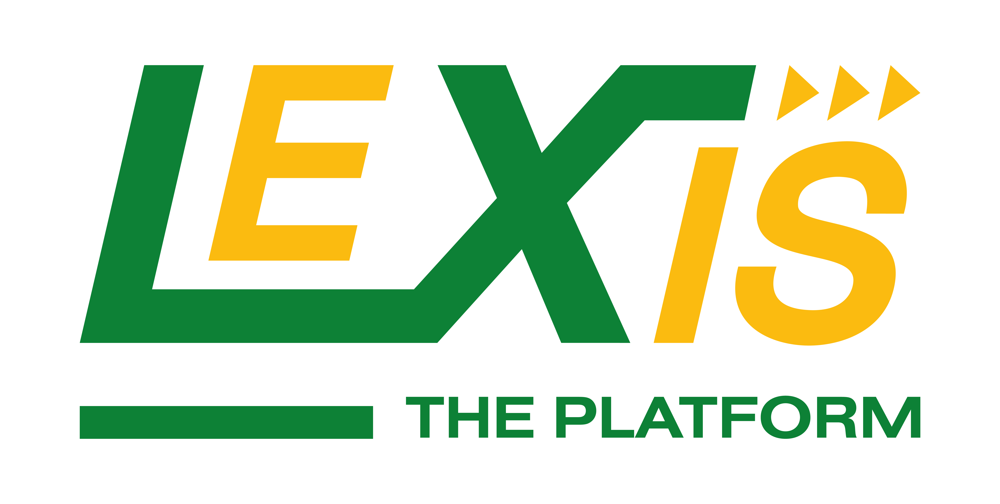
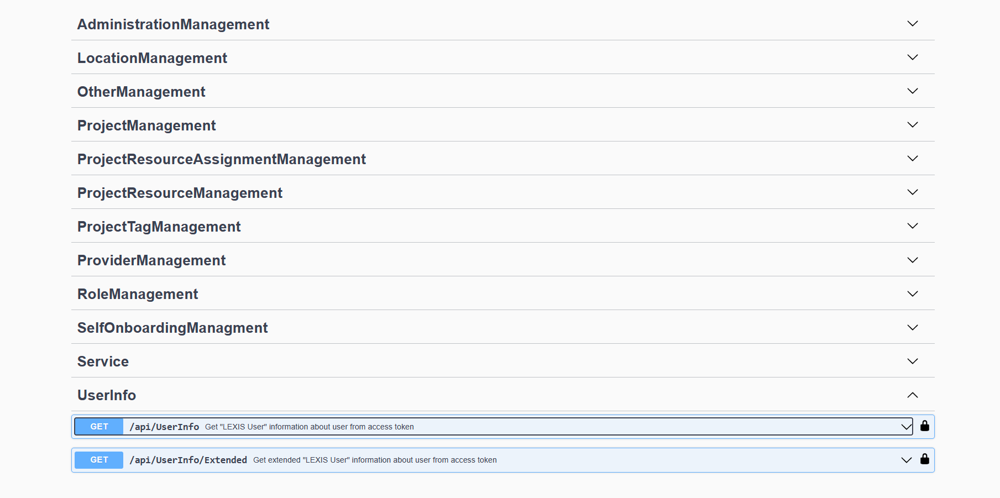

# UserOrg-v2 
 
[](https://opencode.it4i.eu/lexis-platform/backend/userorg/-/commits/develop) [](https://opencode.it4i.eu/lexis-platform/backend/userorg/-/releases)

<!-- badges
*** https://ileriayo.github.io/markdown-badges/#markdown-badges
*** https://gist.github.com/lukas-h/2a5d00690736b4c3a7ba
*** https://dev.to/envoy_/150-badges-for-github-pnk#contact
-->

<!-- MARKDOWN LINKS & IMAGES -->
<!-- https://www.markdownguide.org/basic-syntax/#reference-style-links -->


<!-- PROJECT LOGO -->
<br />
<div align="center">
  <a href="">
    
  </a>

<h3 align="center">UserOrg</h3>

  <p align="center">
    an open-source project that aims to provide a service for managing projects, resources and providers within the LEXIS platform.
    <br />
    <a href="docs/index.md"><strong>Explore the docs</strong></a>
    <br />
    <br />
    <a href="https://opencode.it4i.eu/lexis-platform/backend/userorg/issues">Report Bug</a>
     ‎ 
    <a href="https://opencode.it4i.eu/lexis-platform/backend/userorg/issues">Request Feature</a>
  </p>
</div>

<div style="display: inline-block;">

[](https://opensource.org/licenses/Apache-2.0)  
 


</div>
 
<!-- TABLE OF CONTENTS -->
<details>
  <summary>Table of Contents</summary>
  <ol>
    <li>
      <a href="#about-the-project">About The Project</a>
      <ul>
        <li><a href="#built-with">Built With</a></li>
      </ul>
    </li>
    <li>
      <a href="#getting-started">Getting Started</a>
      <ul>
        <li><a href="#prerequisites">Prerequisites</a></li>
        <li><a href="#installation">Installation</a></li>
      </ul>
    </li>
    <li><a href="#usage">Usage</a></li>
    <li><a href="#roadmap">Roadmap</a></li>
    <li><a href="#contributing">Contributing</a></li>
    <li><a href="#license">License</a></li>
    <li><a href="#contact">Contact</a></li>
    <li><a href="#acknowledgments">Acknowledgments</a></li>
  </ol>
</details>


<!-- ABOUT THE PROJECT -->
## About The Project



UserOrg is an open-source project that aims to provide a service for managing projects, resources and providers within the LEXIS platform. The project is built on ASP.NET Core and is licensed under the Apache License 2.0. The project is maintained by IT4Innovations and is open to contributions from the community.

The project's main features include:

- API for various operations: The project provides an API for creating, updating, assigning and removing entities such as projects, locations, providers, roles and permissions. 
- The API specification is described using OAS3 and contains a list of all available endpoints, schemas and parameters.
- Self-registration: The project supports self-registration for users who want to join a project. The project also allows project managers to accept or reject requests from users.
- Role-based access control: The project implements role-based access control for different entities. Users can have different roles and permissions depending on the project they are assigned to. The project also supports system roles and permissions for platform administrators and provider administrators.
<p align="right">(<a href="#readme-top">back to top</a>)</p>

## Acknowledgement

### e-Infra CZ
This work was supported by the Ministry of Education, Youth and Sports of the Czech Republic through the e-INFRA CZ (ID:90254)

### Built With

  


<p align="right">(<a href="#readme-top">back to top</a>)</p>


<!-- GETTING STARTED -->
## Getting Started

For a detailed developer guide and full documentation, see the documentation index: [docs/index.md](docs/index.md).

API consumers moving off the legacy endpoints: see the [v1 → v2 endpoint migration guide](docs/guides/v1-to-v2-migration.md).

### Prerequisites

* Docker compose
* Docker
* EmailSenderApi

### Installation

1. Prerequisites
   - Docker (Desktop or Engine) running on your machine
   - .NET SDK (matching project; see Directory.Build.props)
   - Aspire CLI installed (see https://aspire.dev for installation instructions)

2. Clone the repository
   ```sh
   git clone https://opencode.it4i.eu/lexis-platform/backend/userorg.git
   cd userorg
   ```

3. Start the development environment (Aspire)
   ```sh
   aspire run
   ```
   - This will start all local services required by the project (databases, Vault, API, etc.) using the Aspire apphost defined in the repository.
   - On first run Aspire may prompt interactively for configuration parameters or secrets. Follow the prompts and provide the requested values. After initial configuration, the same command will bring the full stack up automatically.

4. Check resource status
   ```sh
   aspire list resources
   ```
   - Use the command above to see which services are running and their health. If a service is down, check its console logs with `aspire list console-logs --resource <resourceName>` or restart the resource using the Aspire dashboard or `aspire` commands.

5. Stop the environment
   ```sh
   aspire stop
   ```
   - Alternatively, press Ctrl+C in the terminal where `aspire run` is running.

6. Next steps
   - After the services are running, open the API docs or visit the service endpoints as described in the project documentation (see docs/index.md).
   - To call the API from Scalar under the local Keycloak identity provider (Development only): open the `/api` page of the gateway or of the API (`userorg`), choose **Authorize**, pick the `Oidc` scheme and sign in as `test` / `test`. Scalar then sends the token as `Authorization: Bearer <token>`. It uses the realm's public PKCE client `scalar`, so no client secret reaches the browser; the manual `Bearer` scheme stays available. Without the local Keycloak answer, Scalar shows only the manual `Bearer` scheme.

Note for contributors: see [AGENTS.md](AGENTS.md) for agent guidelines and repository automation details.

<p align="right">(<a href="#readme-top">back to top</a>)</p>


<!-- USAGE EXAMPLES -->
<!-- ## Usage

Use this space to show useful examples of how a project can be used. Additional screenshots, code examples and demos work well in this space. You may also link to more resources.

_For more examples, please refer to the [Documentation](https://example.com)_

<p align="right">(<a href="#readme-top">back to top</a>)</p> -->


<!-- ROADMAP -->
## Roadmap

<!-- - [ ] Feature 1
- [ ] Feature 2
- [ ] Feature 3
    - [ ] Nested Feature -->

See the [open issues](https://opencode.it4i.eu/lexis-platform/backend/userorg/issues) for a full list of proposed features (and known issues).

<p align="right">(<a href="#readme-top">back to top</a>)</p>


<!-- CONTRIBUTING -->
## Contributing

Contributions are what make the open source community such an amazing place to learn, inspire, and create. Any contributions you make are **greatly appreciated**.

If you have a suggestion that would make this better, please fork the repo and create a pull request. You can also simply open an issue with the tag "enhancement".
Don't forget to give the project a star! Thanks again!

1. Fork the Project
2. Create your Feature Branch (`git checkout -b feature/AmazingFeature`)
3. Commit your Changes (`git commit -m 'Add some AmazingFeature'`)
4. Push to the Branch (`git push origin feature/AmazingFeature`)
5. Open a Pull Request

<p align="right">(<a href="#readme-top">back to top</a>)</p>


<!-- LICENSE -->
## License

Distributed under the MIT License. See `LICENSE.txt` for more information.

<p align="right">(<a href="#readme-top">back to top</a>)</p>


<!-- CONTACT -->
## Contact

IT4Innovations - [@twitter_handle](https://twitter.com/it4innovations) - support@lexis.tech

Project Link: [https://opencode.it4i.eu/lexis-platform/backend/userorg](https://opencode.it4i.eu/lexis-platform/backend/userorg)

<p align="right">(<a href="#readme-top">back to top</a>)</p>


<!-- Nuget packages - license mention -->
<!-- from Package Managment Console: 
"Get-Package | Select-Object Id, Version, LicenseUrl, ProjectName" -->

## Used packages
- [SonarAnalyzer.CSharp (9.7.0.75501)](https://licenses.nuget.org/LGPL-3.0-only)
- [MailKit (4.1.0)](https://licenses.nuget.org/MIT)
- [SonarAnalyzer.CSharp (9.7.0.75501)](https://licenses.nuget.org/LGPL-3.0-only)
- [VaultSharp (1.13.0.1)](https://licenses.nuget.org/Apache-2.0)
- [FluentValidation (11.6.0)](https://licenses.nuget.org/Apache-2.0)
- [Microsoft.EntityFrameworkCore (7.0.10)](https://licenses.nuget.org/MIT)
- [log4net (2.0.15)](https://licenses.nuget.org/Apache-2.0)
- [FluentValidation.DependencyInjectionExtensions (36688)](https://licenses.nuget.org/Apache-2.0)
- [Swashbuckle.AspNetCore (36652)](https://licenses.nuget.org/MIT)


<!-- ACKNOWLEDGMENTS -->
<!-- ## Acknowledgments

* []()
* []()
* []() -->

<p align="right">(<a href="#readme-top">back to top</a>)</p>

