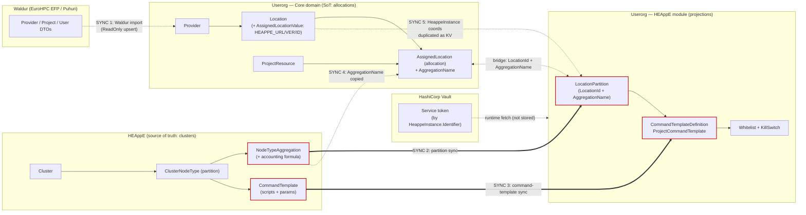

# HPC Cluster & Allocation Entity Lifecycle (HEAppE ↔ Userorg)

This document details the full lifecycle of the entities involved in provisioning
HPC access — from a new hosting provider appearing, through cluster registration
in HEAppE, to a user's allocation becoming usable via command templates.

It reconciles the conceptual lifecycle (see *Cluster lifecycle management.md*) with
the actual entities in two codebases:

- **HEAppE** — <https://github.com/It4innovations/HEAppE> (`master`). Source of
  truth for clusters, partitions, node types, aggregations, and the concrete
  command-template scripts.
- **Userorg** (this repo, `main`). Source of truth for providers, locations,
  resources, and allocations. HEAppE-side objects are *projected* here, keyed
  back to HEAppE, never authored here.

## Two persistence worlds

| World | Namespace / path | Visibility | Owns |
|---|---|---|---|
| **Userorg Core domain** | `UserOrganizationManagement.Domain.Entities` — `src/Core/Domain/Entities` | public | Provider, Location, ProjectResource, AssignedLocation (allocation) |
| **Userorg HEAppE module** | `Heappe.Persistence.Entities` — `src/Modules/Integrations/Heappe/Persistence/Entities` | internal, own DbContext/migrations | Local projections of HEAppE partitions & command templates |
| **HEAppE** | `DomainObjects/*` (external service) | — | Cluster, ClusterNodeType (partition), aggregation, CommandTemplate |

**Bridge keys** between the worlds:

- Core `AssignedLocation.LocationId` + `AssignedLocation.AggregationName`
  ↔ HEAppE-module `LocationPartition.LocationId` + `LocationPartition.AggregationName`.
- HEAppE instance coordinates (`Uri`, `Version`, `Identifier`) are stored as Core
  `AssignedLocationValue` key/value pairs (`HEAPPE_URL`, `HEAPPE_VERSION`,
  `HEAPPE_IDENTIFIER`) and hydrated into the `HeappeInstance` record at runtime.
- Service tokens are **not** stored in Userorg at all — they are pulled from
  HashiCorp Vault by the HEAppE instance `Identifier`.

---

## Phase 1 — A new hosting entity (Provider) appears

**Actor:** LEXIS Platform Admin (national/IT4I path) or Waldur sync (EuroHPC path).

**Userorg entity:** `Provider` — `src/Core/Domain/Entities/Provider.cs`
(`AuditableExtendedServiceIntegrationEntity<Guid>`).

Key fields: `Name`, `Description`, `IsPrivate`, `SupportEmail`, `Country`,
`IList<Location> Locations`, `IList<User>? ResponsibleUsers`. Inherited:
`Mode` (`EOperationMode`), `ServiceName` (default `"Lexis"`), `ExternalId`.

Lifecycle:

1. **Created.** Title/Country/Description as per the conceptual doc.
   - *National (IT4I):* admin POSTs via the Core API input models
     (`src/Core/Domain/ExtModels/UserOrg/InputModels/Provider/`). Row is
     `Mode = Editable`, `ServiceName = "Lexis"` → remains user-editable.
   - *EuroHPC:* created by the Waldur sync (see Phase 4). Upsert matches on
     `ExternalId` + `ServiceName`; row is marked `Mode = ReadOnly` so the UI/API
     refuse edits (external system stays authoritative).
2. **Owns Locations.** A Provider is a container for one or more `Location`s.
3. **Retired.** Soft state via audit fields; Locations must be detached first.

> `Mode` (`Unspecified=0 / ReadOnly=1 / Editable=2`,
> `src/UserOrg.Shared/Persistance/Abstractions/Enums/EOperationMode.cs`) is the
> single flag distinguishing *imported/read-only* from *manually-authored/editable*
> records across Provider, Location, ProjectResource, and AssignedLocation.

---

## Phase 2 — A new cluster appears (HEAppE side)

This phase happens **entirely in HEAppE**; Userorg has no Cluster entity. It is
reproduced here because Userorg allocations later reference these objects by key.

**Actors:** HEAppE team / hosting entity.

### 2a. HEAppE instance provisioning (infra, not an entity)

1. HE creates a VM; the HEAppE team deploys HEAppE Management via Ansible;
   an admin account is created.
2. A new HEAppE **instance** is created (Title, Identifier).
3. The instance is configured: AAI/token handling, polling intervals, callback
   URLs to Userorg, expiration, EFP wiring.

In Userorg this instance is represented only as the `HeappeInstance` record
(`src/Core/Domain/Contracts/HeappeInstance.cs`: `Uri`, `Version`, `Identifier`),
reconstructed from Location values — see Phase 3.

### 2b. Cluster registration — HEAppE `Cluster`

`DomainObjects/ClusterInformation/Cluster.cs` (`ISoftDeletableEntity`, table `Cluster`):

| Field | Type | Notes |
|---|---|---|
| `Name` | string(250) | required |
| `Description` | string(200) | required |
| `MasterNodeName` | string(250) | login node DNS |
| `DomainName` | string(250) | optional |
| `Port` | int? | SSH port |
| `TimeZone` | string(30) | default `UTC` |
| `SchedulerType` | enum | SLURM / PBS / SGE |
| `ConnectionProtocol` | nav | SSH / REST / proxy |
| `ProxyConnection(Id)` | nav / long? | optional jump host |
| `NodeTypes` | `List<ClusterNodeType>` | partitions |
| `FileTransferMethods` | nav | |
| `ClusterProjects` | `List<ClusterProject>` | per-project credentials |
| `CustomConfiguration` | `Dictionary<string,string>?` | |
| `IsDeleted` | bool | soft delete |

### 2c. Partitions — HEAppE `ClusterNodeType`

`DomainObjects/ClusterInformation/ClusterNodeType.cs`:

| Field | Type | Maps to conceptual doc |
|---|---|---|
| `Name`, `Description` | string(250) | Partition name |
| `NumberOfNodes` | int? | |
| `CoresPerNode` | int | Max cores per node (GPUs live in the aggregation/allocation config, not a dedicated column) |
| `Queue` | string(250) | |
| `QualityOfService` | string(40) | |
| `ClusterAllocationName` | string(40) | scheduler allocation/project name |
| `MaxWalltime` | int? | Max walltime |
| `MaxNodesPerUser` / `MaxNodesPerJob` | int? | |
| `ClusterId` | long? | → `Cluster` |
| `ClusterNodeTypeAggregationId` | long? | → aggregation (HW-type grouping + accounting formula) |
| `RequestedNodeGroups` | list | |
| `PossibleCommands` | `List<CommandTemplate>` | which templates run on this partition |

**Aggregations** group node types by hardware type and carry the accounting
formula; a partition points at one via `ClusterNodeTypeAggregationId`. The
aggregation's `Name` is the value later mirrored into Userorg as
`AssignedLocation.AggregationName` — the join key between the two systems.

> **Source-of-truth rule:** HEAppE is authoritative for Clusters. Multiple HEAppE
> instances serving one cluster must be configured *identically*; HEAppE
> management is expected to duplicate an instance's settings.

---

## Phase 3 — Registering a HEAppE endpoint in Userorg (Location)

**Actor:** LEXIS Platform / Provider admin.

**Userorg entity:** `Location` — `src/Core/Domain/Entities/Location.cs`
(`AuditableServiceIntegrationEntity<Guid>`).

Key fields: `ProviderId`, `LocationTypeId`, `Name`, `Description`,
`Endpoint` (login/service endpoint — the natural key on import), `IsPrivate`,
`IsShared` (default true), `DefaultServiceIntegrationUrl`. Relations: `Provider`,
`LocationType` (`LocationType.cs`, `EnumEntity<int>` — Purpose/Domain),
`IList<AssignedLocation>`.

Lifecycle:

1. **Created** under a Provider with an `Endpoint` and a `LocationType`
   (purpose/domain).
2. **HEAppE coordinates are attached as key/value pairs, not columns.** The
   HEAppE URL, version, and identifier are *not* first-class Location columns.
   They are stored per-allocation as `AssignedLocationValue` rows and rebuilt into
   a `HeappeInstance` via `HeappeInstanceExtensions.ToHeappeInstance(...)` reading
   `HEAPPE_URL` / `HEAPPE_VERSION` / `HEAPPE_IDENTIFIER`
   (`ApplicationConstants.Heappe*Key`).
3. **Service token stays in Vault.** At call time
   `credentialsService.GetCredentials(heappeInstance.Identifier)` yields
   `SecretApiKey`, passed to `HeappeService.GetHeappeServiceConnectionInfo(uri, token)`
   (`HeappeService.cs`). Connection is either
   `ServiceTokenHeappeConnectionInfo` (BaseAddress + `ServiceToken`) or
   `SessionCodeHEAppEConnectionInfo`, selected in `HeappeHttpRequestBuilder.cs`.
4. **Referenced by allocations** through `AssignedLocation.LocationId`.
5. **Retired** — must have no active `AssignedLocation`s.

---

## Phase 4 — A user's allocation gets approved

Two entry paths converge on the same entities. The `Mode` flag records which.

### 4a. EuroHPC — imported from Waldur (automatic)

Background pipeline in
`src/Modules/Integrations/WaldurPlatform.Base/Features/BackgroundPeriodicSync/`
(producer/consumer channels: `ProviderConsumer`, `ProjectConsumer`,
`UserConsumer`; `DataCollector/CollectorService.cs` pages the Waldur REST API).
DTOs (`AggregateData`/`ProviderDto`) flow to `IExporter`
(`HostContracts/IExporter.cs`); exporters live in `src/Userorg.Adapter/Waldur/`
(`WaldurExportOrchestrator`, `EFPWaldur/WaldurEfpExporter`, `Puhuri/PuhuriExporter`).

- Upserts match on `ExternalId`+`ServiceName` (Provider) / `Endpoint`+`ServiceName`
  (Location) and copy `Mode` from the DTO — imported rows become **`ReadOnly`**.
- HEAppE URLs come from environment/config:
  `WaldurPlatform.Base/Configuration/HeappeInstancesMapOptions.cs`; per-project
  HEAppE wiring via `Waldur/Base/Heappe/WaldurHeappeProjectInitializer.cs`.
- Two flavors: `Waldur.EFP` (EuroHPC Federation Platform) and `Waldur.Puhuri`.

### 4b. National / IT4I — manual (admin authors it)

Admin submits via Core API input models under
`src/Core/Domain/ExtModels/UserOrg/InputModels/` (`ProjectResource/`,
`ProjectResourceAssignment/`): selects the Location (which carries the HEAppE
URL), quotas, and storage paths. Rows are **`Editable`**, `ServiceName = "Lexis"`.

### Entities produced (both paths)

- **`ProjectResource`** (`src/Core/Domain/Entities/ProjectResource.cs`) — the
  resource: `Name`, `Description`, `PrimaryInvestigatorEmail`, `StartDate`,
  `EndDate`; relations `AssignedProjects`, `AssignedUsers`, `AssignedLocations`.
- **`AssignedProjectResourceToProject`** — links a `ProjectResource` to a
  `Project` (`ProjectId`, `ProjectResourceId`).
- **`AssignedLocation`** — **the allocation itself**
  (`AuditableExtendedServiceIntegrationEntity<Guid>`): `ProjectResourceId`,
  `LocationId`, `AllocationUnitTypeId`, `AllocationUnitCount`, `Description`,
  **`AggregationName`** (bridge key to a HEAppE aggregation/partition), and
  `IList<AssignedLocationValue>` (the `HEAPPE_*` key/values).
- **`AssignedLocationValue`** — `Name`/`Value` bag holding the HEAppE
  coordinates for that allocation.

> **Source-of-truth rule:** LEXIS/Userorg is authoritative for allocations. The
> user submits allocation info and HEAppE *pulls* it (or the hosting entity pushes
> via a well-defined API that LEXIS exposes).

### Cluster initialization for a project

Not an entity but an orchestration:
`src/Modules/Integrations/Heappe/Features/InitializationProjectWithClusters/`
(`ProjectCreationService`) wires an approved project to its HEAppE clusters.

---

## Phase 5 — Command template management

Command templates are HEAppE's mechanism for running parameterized scripts.
HEAppE holds the concrete scripts; the Userorg HEAppE **module** holds a
projection plus governance (whitelist / kill-switch).

### HEAppE side — `CommandTemplate` (`DomainObjects/JobManagement/CommandTemplate.cs`)

`Name`, `Description`, `ExecutableFile`, `ExtendedAllocationCommand`,
`CommandParameters`, `PreparationScript`, `IsGeneric`, `IsEnabled`, `IsDeleted`,
`CreatedAt`/`ModifiedAt`; relations `ClusterNodeTypeId` (→ partition it runs on),
`ProjectId`, `CreatedFromId` (self-reference — duplicated-from), and
`List<CommandTemplateParameter> TemplateParameters`.

### Userorg HEAppE-module projection (`Heappe/Persistence/Entities/`)

- **`LocationPartition`** (`AuditableEntity<Guid>`, internal): `Name`,
  `Description`, `AggregationName`, `LocationId`,
  `IList<ProjectCommandTemplatePartition>` — the module-local projection of a
  HEAppE partition/aggregation, keyed back by `LocationId` + `AggregationName`.
  Synced via `Features/LocationPartitionsSynchronization` /
  `Features/GetLocationPartitions`.
- **`CommandTemplateDefinition`** (`AuditableEntity<Guid>`): `Name`,
  `Description`, `ECommandTemplateType Type`, with
  `CommandTemplateParameterDefinition`s, `ProjectCommandTemplate`s, and
  `CommandTemplateLocationDefinition`s.
- **`CommandTemplateLocationDefinition`**: per-location full script paths —
  `PreparationCommand`, `ExecutionCommand`, `ELocationType LocationType`,
  `CommandTemplateDefinitionId`, `LocationPartitionId?`.
- **`ProjectCommandTemplate`** (`PrimaryIdentifiableEntity<Guid>`): `Name`,
  `Type`, `CommandTemplateDefinitionId?`, `ProjectId`, `ProjectResourceId`,
  `IList<ProjectCommandTemplatePartition>`; rolls partition states up via
  `GetCommandTemplateState(...)`.
- **`ProjectCommandTemplatePartition`**: `CommandTemplateId` (HEAppE numeric id),
  `ECommandTemplateState State`, `LocationPartitionId`.

Lifecycle: a `CommandTemplateDefinition` is created/synced
(`Features/CommandTemplateManagement`, `CommandTemplateSynchronization`),
projected onto each partition as a `ProjectCommandTemplatePartition` whose `State`
tracks the HEAppE-side template, and rolled up into the `ProjectCommandTemplate`
state a project sees.

### Governance — whitelist & kill-switch (ADR-0007 / ADR-0013)

- **`LocationCommandTemplateWhitelist`**: `LocationId`,
  `ProjectCommandTemplateId`, `AddedByUserId`/`AddedAtUtc` — standing allow-list
  of which templates may run at a location.
- **`LocationCommandTemplateKillSwitch`**: `LocationId`, `IsEnforced`,
  `IgnoreWhitelist`, `Reason`, plus enforced/lifted audit — location-wide lockdown
  overriding the whitelist.

Features: `Heappe/Features/{CommandTemplateManagement, CommandTemplatePermissions,
CommandTemplateSynchronization, KillSwitch}`.

---

## End-to-end summary

```
Provider ──1:N──> Location ──1:N──> AssignedLocation (allocation)
  │                  │                    │  AggregationName + LocationId
  │                  │                    │  AssignedLocationValue: HEAPPE_URL/VERSION/IDENTIFIER
  │                  │                    ▼
  │                  │             ProjectResource ──> Project (via AssignedProjectResourceToProject)
  │                  │
  │                  └── bridge ──> HEAppE-module LocationPartition (LocationId + AggregationName)
  │                                        │
  ▼                                        ▼
(Mode: ReadOnly=Waldur import         ProjectCommandTemplate ── ProjectCommandTemplatePartition
       / Editable=manual IT4I)             │                         │ CommandTemplateId (HEAppE)
                                           ▼                         ▼
                              CommandTemplateDefinition      HEAppE Cluster / ClusterNodeType /
                              (+ Location/Parameter defs)     aggregation / CommandTemplate
                              governed by Whitelist + KillSwitch
```

| Conceptual entity | Userorg Core | Userorg HEAppE module | HEAppE |
|---|---|---|---|
| Provider | `Provider` | — | — |
| Location | `Location` | — | — |
| Resource | `ProjectResource` | — | — |
| ResourceAssignment / Allocation | `AssignedLocation`, `AssignedProjectResourceToProject` | — | — |
| Cluster | orchestration only | — | `Cluster` |
| Partition / Aggregation | — | `LocationPartition`, `ProjectCommandTemplatePartition` | `ClusterNodeType` + aggregation |
| CommandTemplate | — | `CommandTemplateDefinition`, `ProjectCommandTemplate` (+ param/location defs) | `CommandTemplate` |

## Component ownership & synchronization map

The diagram below shows every component in the lifecycle, which entity each owns,
and — highlighted in red — the four places where the same data is **synchronized /
duplicated** across a component boundary. Solid red arrows are active pull/sync
jobs; dotted red arrows are copied fields that must be kept in agreement.



### The five synchronization points today

| # | What is duplicated | From → To | Mechanism | Cost |
|---|---|---|---|---|
| 1 | Provider / Project / User | Waldur → Core | `BackgroundPeriodicSync` background job | Necessary — external SoT; keep |
| 2 | Partition + aggregation | HEAppE → HEAppE module | `LocationPartitionsSynchronization` | Drift risk; poll interval |
| 3 | Command template + params | HEAppE → HEAppE module | `CommandTemplateSynchronization` | Drift risk; poll interval |
| 4 | `AggregationName` | HEAppE → Core `AssignedLocation` | copied at allocation authoring | Stale if HEAppE renames aggregation |
| 5 | HEAppE instance coords (`HEAPPE_URL/VERSION/IDENTIFIER`) | Location → per-allocation KV | copied into `AssignedLocationValue` per allocation | N-way duplication across allocations |

SYNC 1 is unavoidable (Waldur is an external system of record). SYNC 2–5 are the
target of this analysis: they exist only because HEAppE-owned data (partitions,
aggregations, templates, instance identity) has been **copied into Userorg tables**.

### Goal: each entity lives in exactly one component

The guiding rule: **an entity is owned by the component that is its source of
truth, and every other component references it by a stable key instead of copying
its state.** Applying that rule:

- Clusters, partitions, aggregations (incl. accounting formula) and command-template
  *scripts* → **owned by HEAppE only**.
- Providers, locations, resources, allocations → **owned by Userorg Core only**.
- Governance (whitelist / kill-switch) → **owned by Userorg** (it is a Userorg
  policy over HEAppE templates, not HEAppE data) — this one is *correctly* single-homed
  already.

### How to minimize each sync

**SYNC 2 & 3 (partition / command-template projection) — the biggest win.**
Today the HEAppE module keeps its own `LocationPartition` and
`CommandTemplateDefinition`/`ProjectCommandTemplate` tables that mirror HEAppE.
Options, cheapest first:

1. **Read-through, don't store.** Replace the projection tables with a thin
   query-time HEAppE client call (partitions/templates fetched via the existing
   `HeappeService` connection, cached in memory with a short TTL). Userorg keeps
   only what is genuinely Userorg-owned: the whitelist/kill-switch rows and the
   `ProjectCommandTemplate` *selection* (which template a project chose), keyed by
   the HEAppE numeric `CommandTemplateId` — **not** the template body. This deletes
   SYNC 2 and reduces SYNC 3 to storing a foreign id.
2. If a local cache must persist (offline resilience), make it an explicit
   **cache** (single `last_synced_at`, invalidated on demand) rather than a
   first-class entity with its own migrations — so nobody treats it as a second SoT.

**SYNC 4 (`AggregationName` on the allocation).** The allocation genuinely needs
to point at *one* aggregation — that reference is legitimate. Minimize drift by
storing HEAppE's **stable aggregation id**, not the display `Name`, so a rename in
HEAppE doesn't silently break the bridge. The `LocationId + AggregationName` bridge
key becomes `LocationId + AggregationId`.

**SYNC 5 (HEAppE instance coords duplicated per allocation).** Move `HEAPPE_URL /
VERSION / IDENTIFIER` **up to the Location** (or to a small `HeappeInstance` row the
Location references) instead of copying them into every `AssignedLocationValue`. All
allocations at a location share one instance, so this is N→1 deduplication with no
behavioural change — `ToHeappeInstance(...)` reads from the Location instead of the
allocation.

### Target picture

After the above, the only remaining cross-component data flows are:

- **SYNC 1** (Waldur → Core) — external, unavoidable.
- **One reference id** per direction across the HEAppE bridge
  (`AssignedLocation` → HEAppE `AggregationId`; `ProjectCommandTemplate` → HEAppE
  `CommandTemplateId`) — a foreign key, not a replicated row.
- **Runtime token fetch** from Vault — already stateless, keep.

No HEAppE-owned entity would live in a Userorg table, and no Userorg-owned entity
would live in HEAppE. The HEAppE module shrinks to: governance tables + selection
foreign-keys + a read-through client.

> Trade-off: read-through couples Userorg availability to HEAppE being reachable
> for partition/template *reads*. Given tokens are already fetched live from Vault
> per call, that coupling largely exists already; the short-TTL cache in option 1
> bounds it. // ponytail: prefer deleting the projection tables over building a
> smarter sync — the cheapest sync is the one that isn't there.

### Open questions carried from the conceptual doc

- **Default command templates** — who defines the baseline set, and how are
  scripts and their parameters updated/versioned across HEAppE instances?
- **Push vs pull for allocations** — LEXIS pulls today; a well-defined LEXIS API
  the hosting entity pushes to remains a design option (Phase 4).
- **Multi-instance parity** — no automated guarantee that multiple HEAppE
  instances for one cluster stay identically configured; relies on HEAppE
  management's duplicate-instance feature.
