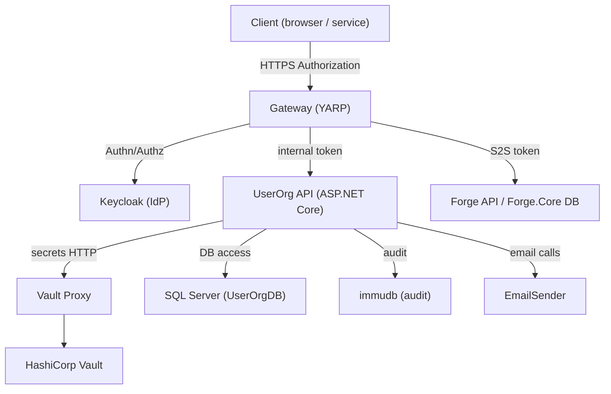
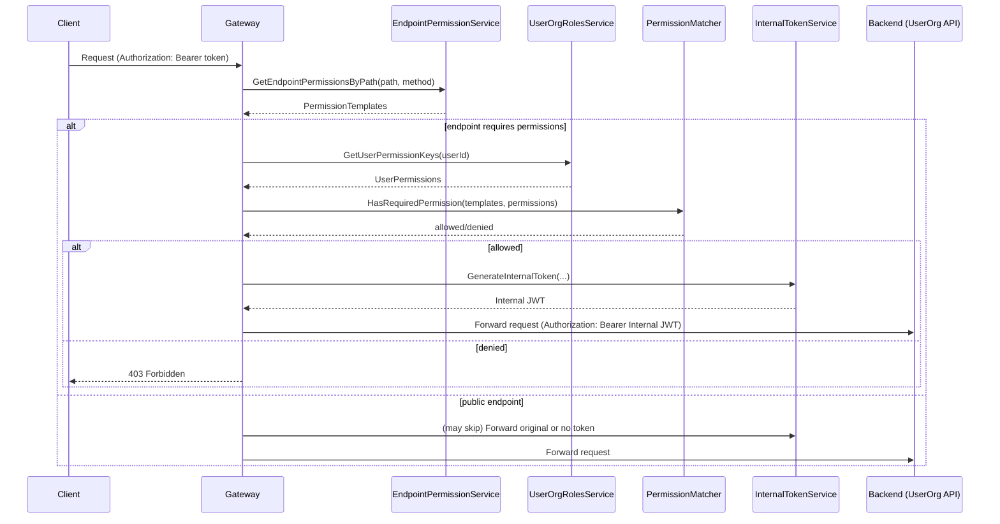
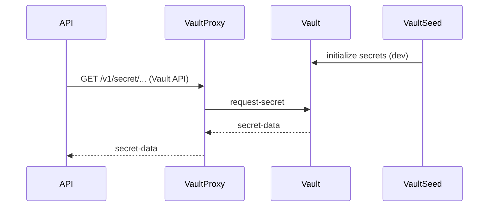

# Architecture diagrams (Mermaid)

This file contains simple mermaid diagrams illustrating the main components and flows described by the ADRs. You can render these diagrams using mermaid.live or include them in MkDocs / GitHub by enabling mermaid rendering.

## Component diagram

## Gateway authorization sequence

## Vault / secrets flow

