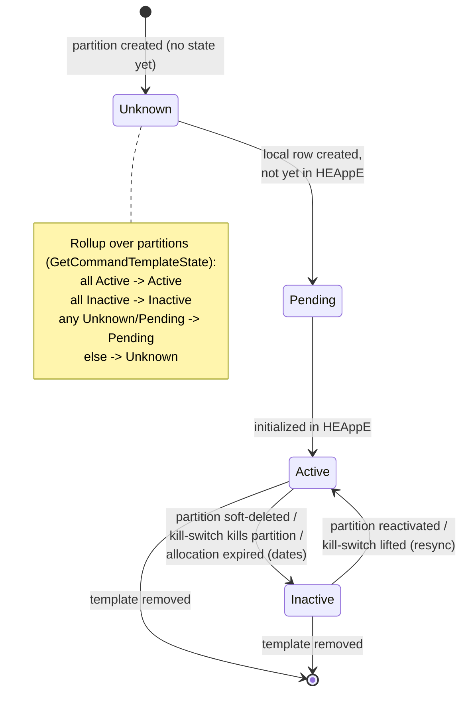

# Entity creation & lifecycle — HEAppE ↔ Userorg (kdo / kdy / kde / jak)

Analýza reálného kódu obou komponent (Userorg `main`, HEAppE `master`): jak
každá entita vzniká, kdo ji vytváří, čím je to spuštěno a kde v kódu.
Doplňuje [ownership přehled](heappe-userorg-entity-ownership.md).

## Klíčové rozlišení: dvě cesty vzniku (Userorg)

Každá `AuditableServiceIntegrationEntity` nese `EOperationMode Mode`
(`src/UserOrg.Shared/Persistance/Abstractions/BaseEntities/AuditableServiceIntegrationEntity.cs`).
Mode je diskriminátor obou cest — a `RecordReadOnlyException`
(`src/Core/Domain/Exceptions/RecordReadOnlyException.cs`) brání editaci
ReadOnly (Waldur-vlastněných) záznamů přes admin API.

| Cesta | Mode | ServiceName | Kde | Trigger |
|---|---|---|---|---|
| **Waldur import** | `ReadOnly` | `"EFP"` / Waldur | `src/Userorg.Adapter/Waldur/EFPWaldur/WaldurEfpExporter.cs` (+ `Puhuri/PuhuriExporter.cs`) | background pipeline `WaldurPlatform.Base/Features/BackgroundPeriodicSync/*` → `WaldurExportOrchestrator` |
| **Manuální admin API** | `Editable` | default | factory `ConvertToEntity(...)` v `src/Core/Application/UserOrg/ConvertorExtensions.cs` | admin `XxxCreate` API volání |

---

## Userorg — vznik po entitách

| Entita | Kdo / kde (manuál) | Kdo / kde (Waldur) | Jak |
|---|---|---|---|
| **Provider** | `ConvertorExtensions.ConvertToEntity(ProviderCreate)` | `WaldurEfpExporter.ExportData(ProviderDto)` → `orchestrator.EnsureProviderAsync` | `Id=Guid.CreateVersion7()`; Waldur: `ExternalId=provider.Id`, create-or-update |
| **Location** | `ConvertToEntity(LocationCreate, Provider, LocationType)` | `WaldurEfpExporter.ExportData` (agreguje podle SSH URL, `AggregateLocationsBySshUrl`) | Waldur seskupí lokace podle SSH URL |
| **ProjectResource** | `ConvertToEntity(ProjectResourceCreate)` | `WaldurEfpExporter.ExportData(projectData)` → `EnsureProjectResourcesAsync` | Waldur: `StartDate/EndDate` z Waldur `Created/EndDate` (EndDate default `MaxValue`); `IsDeleted` když všechny stavy `terminated` |
| **AssignedLocation** (alokace) | `ConvertToEntity(ProjectResourceAssignmentCreate)` | `WaldurEfpExporter` (`ExternalId=resource.Id`) | viz níže KV páry |
| **AssignedLocationValue** | `ConvertToEntity(KeyValuePair)` z `resAllocation.Specifications` | `ExtractAllocationUnitAndRemaining` | **HEAPPE_URL/VERSION/IDENTIFIER nemají dedikovaný kód** — jsou to obyčejné KV řádky, jejichž `Name` = konstanty v `ApplicationConstants.cs`. Ve Waldur cestě přicházejí jako nenamapované „remaining" offering komponenty; čtou se přes `HeappeInstance.ToHeappeInstance(...)` |
| **AssignedProjectResourceToProject** | join handler | `EnsureProjectResourcesAsync` (cascade) | plain join row, žádná factory, materializuje se v grafu `Project.AssignedProjectResources` |

---

## Userorg HEAppE-modul — vznik přes synchronizaci

Entity v `src/Modules/Integrations/Heappe/Persistence/Entities/` (`internal`).
**Není žádný cron.** Sync běží přes in-process `Channel<WorkItem>` konzumovaný
`BackgroundService`em.

**Spouštěče sync work-itemů:**
- Cascade z Waldur exportu — `WaldurExportOrchestrator.cs` zapíše `WorkItem` po každém resource (+ `WaldurHeappeProjectInitializer.InitializeIfNeededAsync`).
- On-demand — `HeappeSynchronizationService.cs` (`TryWrite`), nebo HTTP `POST /CommandTemplate/Synchronization`.
- Lift kill-switche — `KillSwitchAdminHandler.cs` re-enqueue.
- Konzument — `Heappe/Features/BackgroundSync/ChannelWorker.cs` (4 paralelní, 30-min timeout) → `WorkItemProcessor` → `IProjectCommandTemplateSyncService`.

| Entita | Kdo / kde | Zdroj |
|---|---|---|
| **LocationPartition** | `LocationPartitionsSynchronizationService.SynchronizationLocationQueuesAsync` | **živý dotaz na HEAppE cluster**; soft-delete/reactivate flipováním `IsDeleted` (kaskáduje na child partitiony) |
| **ProjectCommandTemplate** + **…Partition** | `ProjectCommandTemplateCreateService.CreateProjectCommandTemplate` (factory `ProjectCommandTemplate.Create/CreateWithDefinition`) | sync `ProjectCommandTemplateSyncService`, nebo manuál `POST CommandTemplates` (stamp `Type=UserDefined`) |
| **CommandTemplateDefinition** | **seed data (5 řádků)** — `HeappeDbInitializerService.StartAsync` → `SeedAsync` při startu | NENÍ ze syncu; sync je jen čte |
| **LocationCommandTemplateKillSwitch / Whitelist** | `KillSwitch/KillSwitchAdminHandler.cs` (admin API) | ADR-0007/0013; kill-switch 1 řádek/Location (last-write-wins), whitelist podle interního `ProjectCommandTemplateId` |

---

## HEAppE — vznik cluster-side entit

**Jednotná cesta:** Admin REST API → `ManagementController` → `ManagementLogic`
→ `UnitOfWork` repo → `Save()`. **Žádný seed/config/migrace** — vše runtime přes
autentizované management API, každý endpoint gated na roli **Administrator**
(`ValidateUserPermissions`).

| Entita | Create metoda (`ManagementLogic`) | Endpoint |
|---|---|---|
| **Cluster** | `CreateCluster(name, description, masterNodeName, schedulerType, protocol, timeZone, port?, …)` | `POST /heappe/management/Cluster` |
| **ClusterNodeType** (partition) | `CreateClusterNodeType(…, coresPerNode, queue, qos, maxWalltime?, clusterId?, clusterNodeTypeAggregationId?)` | `POST /ClusterNodeType` |
| **ClusterNodeTypeAggregation** | `CreateClusterNodeTypeAggregation(name, description, allocationType, validityFrom, validityTo?)` | `POST /ClusterNodeTypeAggregation` |
| **Accounting** (formule!) | `CreateAccounting(formula, validityFrom, validityTo?)` | `POST /Accounting` |
| **CommandTemplate** | `CreateCommandTemplate` / `CreateGenericCommandTemplate` / `CreateCommandTemplateFromGeneric` | `POST /CommandTemplate` / `/GenericCommandTemplate` / `/CommandTemplateFromGeneric` |

**Accounting formule NENÍ na aggregation entitě.** Žije na samostatné
`Accounting` (`Formula` string, vlastní `ValidityFrom/ValidityTo`, metoda
`IsValid(startTime)`), spojené s aggregation přes M:N join
`ClusterNodeTypeAggregationAccounting`. `ClusterNodeTypeAggregation` má vlastní
`ValidityFrom` (required) / `ValidityTo?` a `AllocationType`.

**CommandTemplate flags:**
- `IsGeneric` — nastaven při vzniku podle create metody, nikdy se nepřepíná. `CreateCommandTemplateFromGeneric` validuje `source.IsGeneric==true`, nový má `IsGeneric=false` + `CreatedFrom=<generic>` (self-reference = „vytvořeno z").
- `IsEnabled` — default true, přepíná se přes `Modify…(modelIsEnabled)`.
- `IsDeleted` — soft delete přes `Remove…`.

**Read endpointy pro Userorg read-through** (`ClusterInformationController`, stačí
platný `sessionCode`, ne admin): `GET ListAvailableClusters` vrací clustery
**s vnořenými node types a command templates** — přirozený cíl read-through
klienta. Admin reads (`GET /Clusters`, `/ClusterNodeTypes`,
`/ClusterNodeTypeAggregations`, `/Accountings`, `/CommandTemplates`) vyžadují
Administrator.

---

## Enumy

**`ECommandTemplateState`** (`Heappe/Persistence/Enums/ECommandTemplateState.cs`):
`Unknown=0` · `Pending=1` (lokálně vytvořeno, ještě ne v HEAppE) · `Active=2`
(inicializováno v HEAppE) · `Inactive=3`.

**`ECommandTemplateType`**: `Unknown=0` · `SystemDefined=1` · `UserDefined=2` · `Generic=3`.

---

## Stavový diagram — ProjectCommandTemplate (jediná entita s netriviálním automatem)

Rollup přes partitiony (`ProjectCommandTemplate.GetCommandTemplateState`):
killed-partition Active nejdřív degraduje na Inactive; pak all-Active→Active,
all-Inactive→Inactive, jakýkoli Unknown/Pending→Pending, jinak Unknown.

## Expirace alokace — čistě datová, žádný job

Expirace je **porovnání StartDate/EndDate vůči `DateTime.UtcNow`**, žádný časovač
nepřeklápí stav:
- **Při syncu (write):** `ProjectCommandTemplateSyncService.ProcessAllocationExpiration` — `isActive = project i resource v okně [Start,End]`; když expirováno, bulk-flip všech partition states na `Inactive` (`ExecuteUpdateAsync`) a přeruší sync. Běží jen při zpracování `WorkItem`u.
- **Při čtení (read):** `CommandTemplateManagementService.CheckAllocationExpiration` — stejná kontrola, `isExpired` se skládá do odpovědi přes `GetCommandTemplateState(...).ToResponseType(isExpired)`. Takže expirace se projeví v API i když persistované stavy ještě nebyly flipnuté.

ADR-0011 explicitně: expirace alokace je mimo záruku kill-switche.

## Ostatní entity — bez stavového automatu

`Provider`, `Location`, `ProjectResource`, `AssignedLocation`, `Cluster`,
`ClusterNodeType`, `ClusterNodeTypeAggregation`, `Accounting` mají jen společný
triviální lifecycle: `created → (Editable | ReadOnly) → IsDeleted (soft-delete)`.
HEAppE `Accounting`/`Aggregation` navíc nesou časové okno `ValidityFrom/ValidityTo`
(platnost, ne stav) — expirace se vyhodnocuje `IsValid(startTime)` při čtení.
