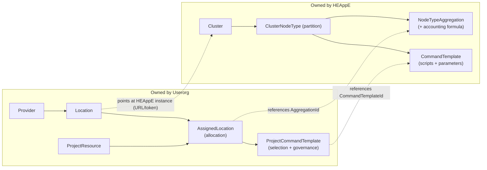

# Entity ownership — HEAppE ↔ Userorg

Přehled entit sdílených mezi HEAppE a Userorgem: kdo kterou vlastní a které se
vzájemně využívají. Cílový stav — každá entita žije v jedné komponentě, přes
hranici jde jen **referenční id**, ne kopie dat.

## Vlastnictví

| Entita | Vlastník | Kdo ji využívá (referencí) |
|---|---|---|
| Cluster | **HEAppE** | Userorg `Location` (přes URL/token instance) |
| ClusterNodeType (partition) | **HEAppE** | — |
| NodeTypeAggregation (+ accounting formula) | **HEAppE** | Userorg `AssignedLocation` (přes `AggregationId`) |
| CommandTemplate (scripty + parametry) | **HEAppE** | Userorg `ProjectCommandTemplate` (přes `CommandTemplateId`) |
| Provider | **Userorg** | — |
| Location | **Userorg** | ukazuje na HEAppE instanci (URL/token) |
| ProjectResource | **Userorg** | — |
| AssignedLocation (alokace) | **Userorg** | referuje HEAppE aggregation |
| ProjectCommandTemplate (výběr + governance) | **Userorg** | referuje HEAppE command template |

## Hranice mezi komponentami

Přes hranici HEAppE ↔ Userorg vedou pouze 3 vazby, každá jen jako **referenční id**:

- `Location` → HEAppE **instance** (URL + token z Vaultu)
- `AssignedLocation` → HEAppE **AggregationId**
- `ProjectCommandTemplate` → HEAppE **CommandTemplateId**

Vše nalevo patří HEAppE, vše napravo Userorgu. Žádná HEAppE entita nežije v
Userorg tabulce a naopak.
