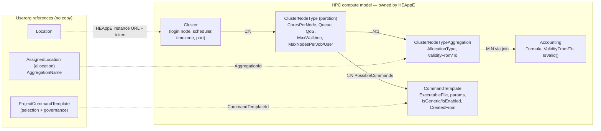
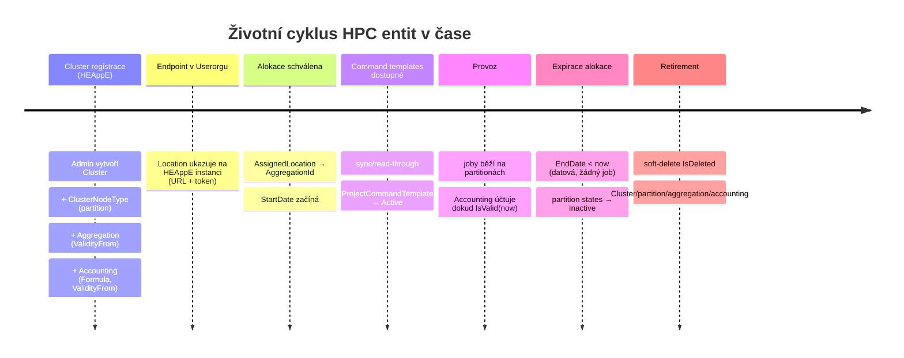
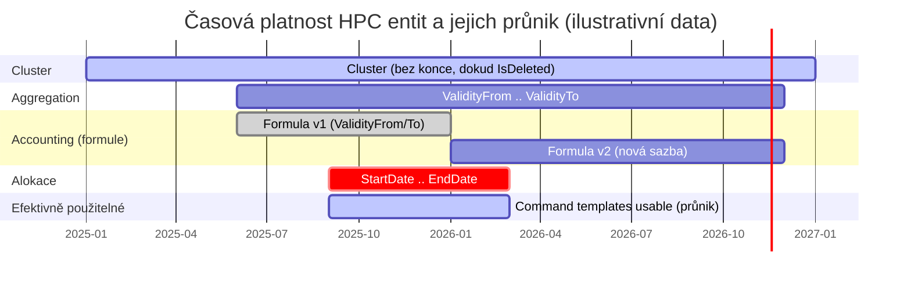
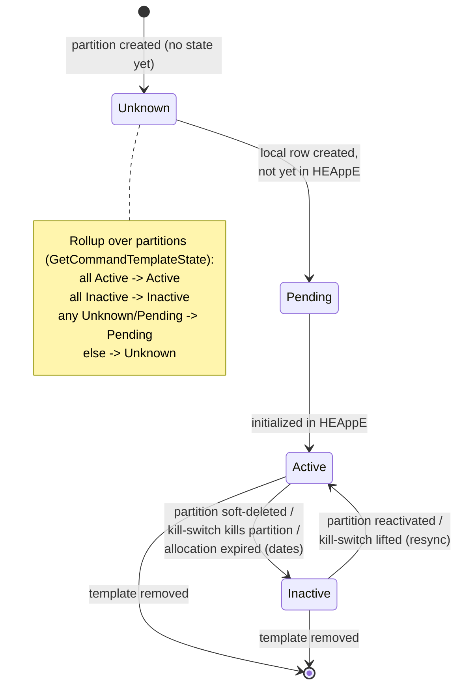

# HPC compute entities — HEAppE ↔ Userorg

Zaměřeno na **HPC (high performance computing) výpočetní entity**: cluster,
partitiony, agregace, účtovací formule a command templates. Org/admin entity
(Provider, ProjectResource, User) jsou mimo rozsah — viz
[creation lifecycle](heappe-userorg-entity-creation.md) a
[ownership](heappe-userorg-entity-ownership.md).

HPC výpočetní model vlastní **HEAppE** (source of truth). Userorg na něj jen
**odkazuje** referenčním id, nekopíruje jeho stav.

## HPC topologie a vazba do Userorgu

## Životní cyklus v čase

## Časová platnost a její průnik

HPC entity nesou **dva různé typy času**:
- **Platnost (validity window):** `Aggregation.ValidityFrom/To` a
  `Accounting.ValidityFrom/To` — vyhodnocuje se `IsValid(now)` při čtení.
- **Alokace (allocation window):** `AssignedLocation`/`ProjectResource`
  `StartDate/EndDate` — čistě datové porovnání vůči `UtcNow`.

Command template je v okamžiku *T* skutečně použitelný jen v **průniku** všech
oken (alokace aktivní ∧ aggregation platná ∧ accounting platné ∧ template
Active/Enabled ∧ ne kill-switch):

Pozorování z grafu:
- **Accounting se verzuje na časové ose** — formule v1 skončí, v2 (nová sazba)
  navazuje; job se účtuje formulí platnou v čase jeho startu (`IsValid(startTime)`).
- **Alokace je vnitřní okno** — obvykle užší než platnost aggregation/accounting;
  proto je efektivně použitelné okno určeno alokací, dokud ji nepřekročí konec
  platnosti aggregation/accounting.
- **Cluster nemá konec** — žije dokud `IsDeleted=false`.

## HPC entity — pole a vlastnictví

Vše vlastní **HEAppE**; entity žijí v `DomainObjects/`.

| Entita | Klíčová pole | Vazby |
|---|---|---|
| **Cluster** `ClusterInformation/Cluster.cs` | `Name`, `MasterNodeName` (login node), `DomainName`, `Port`, `TimeZone`, `SchedulerType` (SLURM/PBS/SGE), `ConnectionProtocol`, `CustomConfiguration`, `IsDeleted` | `NodeTypes: List<ClusterNodeType>`, `ClusterProjects`, `ProxyConnection?` |
| **ClusterNodeType** (partition) `ClusterInformation/ClusterNodeType.cs` | `Name`, `NumberOfNodes?`, `CoresPerNode`, `Queue`, `QualityOfService`, `ClusterAllocationName`, `MaxWalltime?`, `MaxNodesPerUser/Job?`, `IsDeleted` | `ClusterId`, `ClusterNodeTypeAggregationId?`, `PossibleCommands: List<CommandTemplate>` |
| **ClusterNodeTypeAggregation** `JobManagement/ClusterNodeTypeAggregation.cs` | `Name`, `AllocationType`, `ValidityFrom` (req), `ValidityTo?`, `IsDeleted` | `ClusterNodeTypes`, `ClusterNodeTypeAggregationAccountings` (join → Accounting) |
| **Accounting** (formule) `JobManagement/Accounting.cs` | **`Formula`**, `ValidityFrom` (req), `ValidityTo?`, `ConsumedResources`, `IsValid(startTime)` | M:N s aggregation přes `ClusterNodeTypeAggregationAccounting` |
| **CommandTemplate** `JobManagement/CommandTemplate.cs` | `ExecutableFile`, `CommandParameters`, `PreparationScript`, `ExtendedAllocationCommand`, `IsGeneric`, `IsEnabled`, `IsDeleted` | `ClusterNodeTypeId?`, `ProjectId?`, `CreatedFromId?` (self-ref), `TemplateParameters` |

**Účtovací formule je oddělená.** `Accounting.Formula` má vlastní okno platnosti
a přes join se váže na aggregation → jedna formule může sloužit více agregacím,
každá s nezávislým `ValidityFrom/To`.

## Userorg reference (jediné 3 vazby přes hranici)

| Userorg entita | Ukazuje na | Přes |
|---|---|---|
| `Location` | HEAppE **instance** clusteru | URL + token (token z Vaultu podle `HeappeInstance.Identifier`) |
| `AssignedLocation` (alokace) | `ClusterNodeTypeAggregation` | `AggregationName` → doporučeno migrovat na stabilní `AggregationId` |
| `ProjectCommandTemplate` | `CommandTemplate` | numerické `CommandTemplateId` |

Žádná HPC entita nežije v Userorg tabulce. Userorg-modul drží jen *selekci*
(který template projekt zvolil) + governance (whitelist/kill-switch), ne tělo
šablony.

## Vznik HPC entit (HEAppE)

**Jednotná cesta:** Admin REST API → `ManagementController` → `ManagementLogic`
→ `Save()`. Žádný seed/config — vše runtime, gated na roli **Administrator**.

| Entita | Create metoda | Endpoint |
|---|---|---|
| Cluster | `CreateCluster(...)` | `POST /heappe/management/Cluster` |
| ClusterNodeType | `CreateClusterNodeType(..., clusterId?, clusterNodeTypeAggregationId?)` | `POST /ClusterNodeType` |
| Aggregation | `CreateClusterNodeTypeAggregation(name, description, allocationType, validityFrom, validityTo?)` | `POST /ClusterNodeTypeAggregation` |
| Accounting | `CreateAccounting(formula, validityFrom, validityTo?)` | `POST /Accounting` |
| CommandTemplate | `CreateCommandTemplate` / `CreateGenericCommandTemplate` / `CreateCommandTemplateFromGeneric` | `POST /CommandTemplate` / `/GenericCommandTemplate` / `/CommandTemplateFromGeneric` |

**Read pro Userorg (read-through):** `ClusterInformationController.ListAvailableClusters`
(stačí `sessionCode`, ne admin) vrací clustery **s vnořenými partition a command
templates** — přirozený cíl, kdyby Userorg nahradil dnešní sync živým čtením.

## CommandTemplate — flags & derivace

- `IsGeneric` — nastaven při vzniku (`CreateGenericCommandTemplate` → true), nepřepíná se.
- `CreateCommandTemplateFromGeneric` — validuje `source.IsGeneric==true`, nový má `IsGeneric=false` + `CreatedFrom=<generic>` (= „vytvořeno z" reusable masteru).
- `IsEnabled` — default true, přepíná `Modify…(modelIsEnabled)`.
- `IsDeleted` — soft delete přes `Remove…`.

## Jediný netriviální stav — výběr CommandTemplate v Userorgu

`ECommandTemplateState`: `Unknown=0` · `Pending=1` (lokálně, ne v HEAppE) ·
`Active=2` (inicializováno v HEAppE) · `Inactive=3`.

Expirace alokace je **čistě datová** (`StartDate/EndDate` vs `UtcNow`), žádný job:
degraduje partition states na `Inactive` při syncu, a promítá se do API i při čtení.
HEAppE `Aggregation`/`Accounting` mají `ValidityFrom/To` — platnost (vyhodnocená
`IsValid()` při čtení), ne stav.

## Cluster/partition/aggregation/accounting — lifecycle

Žádný stavový automat: `created → (aktivní) → IsDeleted (soft-delete)`.
Aggregation a Accounting navíc s časovým oknem platnosti. Cluster je source of
truth — víc HEAppE instancí pro jeden cluster musí být konfigurováno identicky
(HEAppE management umí instanci duplikovat).