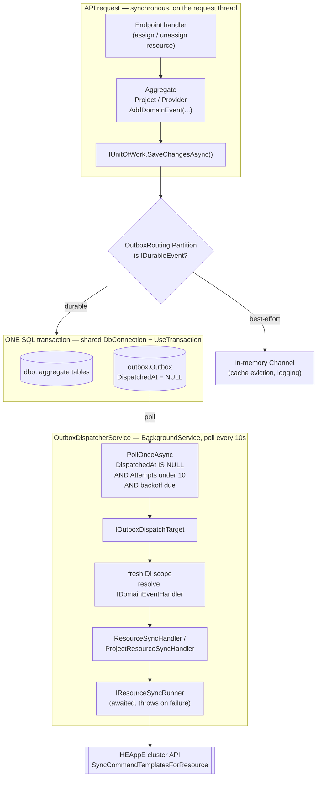
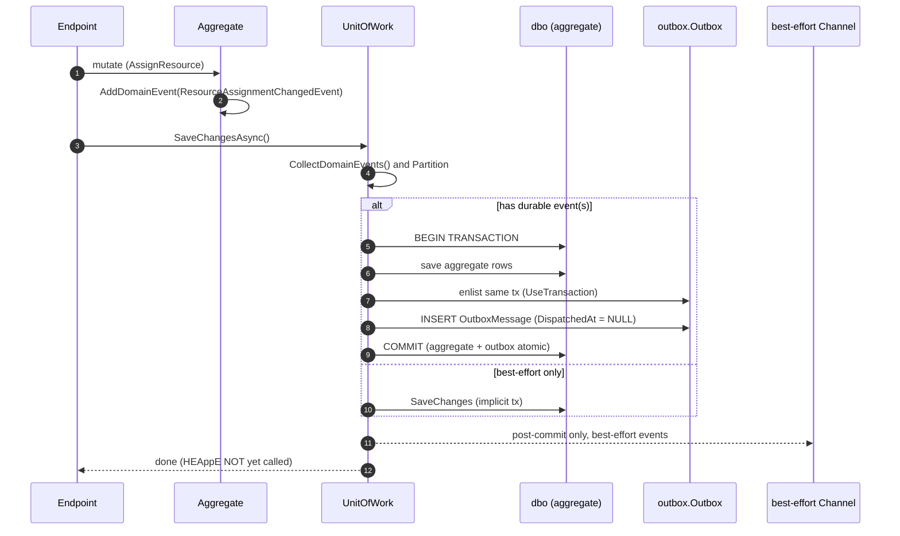
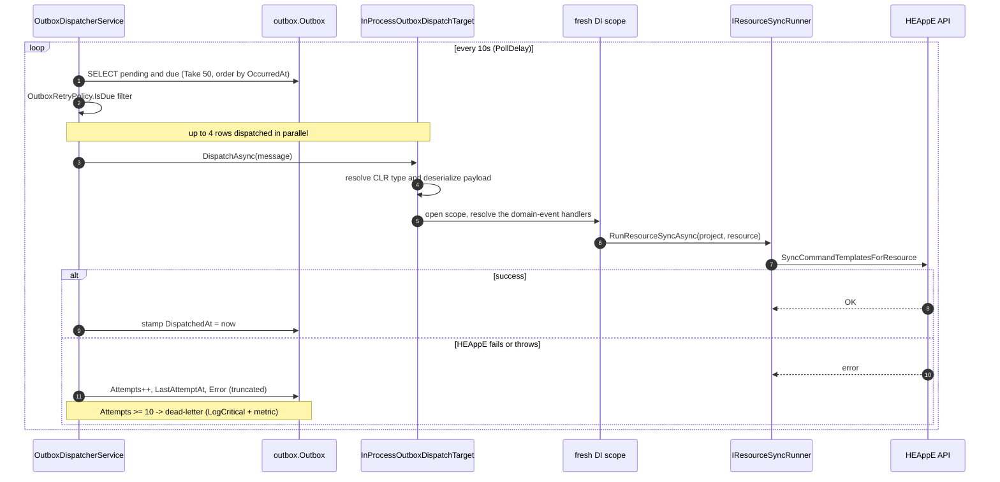
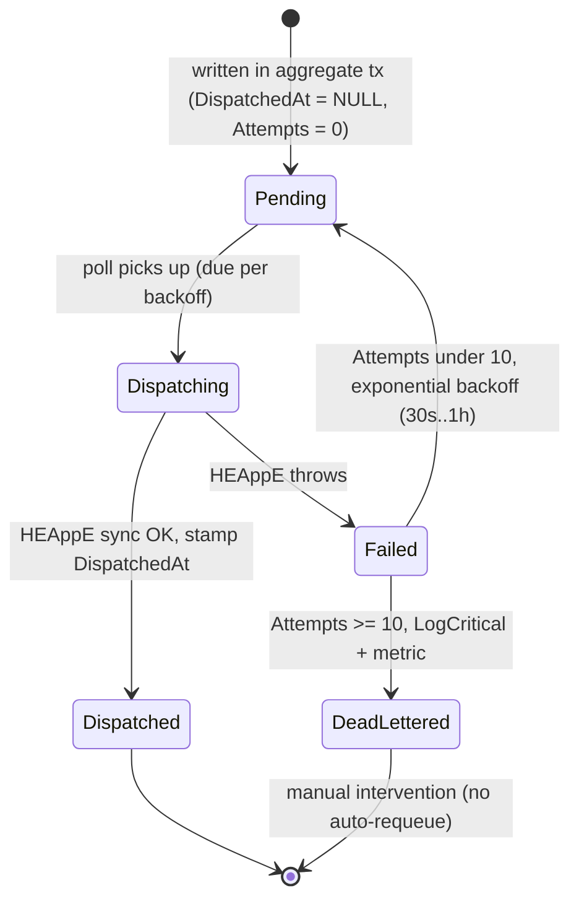

# Transactional Outbox — Flow & Behaviour

**Status:** Living reference · **Scope:** the durable delivery of HEAppE-sync domain
events in the Core module.
**Related ADRs:** [0028](adr/0028-transactional-outbox-for-domain-events.md) (decision),
[0040](adr/0040-outbox-dispatcher-delivers-sync-to-completion.md) (delivery boundary),
[0041](adr/0041-outbox-dedicated-schema-isolated-persistence-unit.md) (persistence unit),
0054 (this session's hardening — observability, dead-letter, trigger retirement).

---

## 1. Why the outbox exists (the one problem it solves)

This is a **modular monolith** — the outbox is **not** here because we are distributed
and it is **not** a message broker. It exists for exactly one reason: there is a single
external side-effect that must not be silently lost.

When an API request assigns or unassigns a `ProjectResource`, two stores must end up
consistent:

1. **our SQL database** (the assignment row), and
2. **HEAppE** — the external HPC cluster-management service that must be told to
   synchronise the resource's command templates.

These cannot be committed atomically: HEAppE is an HTTP call, not a participant in our
DB transaction. That is a **dual-write problem**, and it exists in a monolith just as
much as in microservices — the boundary that matters is *process ↔ HEAppE*, not
*module ↔ module*. Hexagonal architecture makes the sync a clean **port**
(`IResourceSyncRunner`); it does **not** remove the atomicity gap.

The failure the old in-memory path had:

> The process crashes / restarts / **is redeployed** between the DB commit and the
> HEAppE call. The in-memory `Channel<WorkItem>` loses the queued work. SQL says
> "assigned", HEAppE never hears about it → silent divergence between our state and the
> cluster's, discovered only when a user notices the cluster lacks a resource they own.

The outbox closes this by persisting the **intent to deliver** in the *same transaction*
as the aggregate change, then delivering it as a separate, durable, retryable step.

### What we deliberately do NOT do (ADR-0028)

- **No message broker** (Kafka / RabbitMQ / SQS). The outbox is one SQL table + one
  in-process polling `BackgroundService`. Minimal form.
- **No outbox for module-to-module events.** In-process best-effort events (cache
  eviction, logging) go through a plain in-memory channel. The outbox is reserved for
  `IDurableEvent` — events crossing into an external system with a durability
  requirement. Today that is exactly the two HEAppE-sync events.

---

## 2. Components & data flow

| Piece | File | Role |
|---|---|---|
| `OutboxMessage` | `Core.DataAccess/Outbox/OutboxMessage.cs` | The row: `Id, Type, Payload, OccurredAt, DispatchedAt?, Attempts, LastAttemptAt?, Error?`. |
| `OutboxDbContext` | `Core.DataAccess/Outbox/OutboxDbContext.cs` | Own `outbox` schema, own `__EFMigrationsHistory`, filtered index on `DispatchedAt IS NULL`. |
| `OutboxRouting` | `Core.DataAccess/Outbox/OutboxRouting.cs` | `Partition` (durable vs best-effort) + `ToOutboxMessage` (serialise). |
| `UnitOfWork` | `Core.DataAccess/Contexts/DatabaseContext.UnitOfWork.cs` | Writes durable rows in the aggregate transaction. |
| `OutboxDispatcherService` | `Core.DataAccess/Outbox/OutboxDispatcherService.cs` | The poller. |
| `IOutboxDispatchTarget` | `Core.DataAccess/Outbox/IOutboxDispatchTarget.cs` | Delivery seam (swappable). |
| `InProcessOutboxDispatchTarget` | `Core.DataAccess/Outbox/InProcessOutboxDispatchTarget.cs` | Re-runs the event through `IDomainEventHandler` in a fresh scope. |
| `OutboxRetryPolicy` | `Core.DataAccess/Outbox/OutboxRetryPolicy.cs` | `MaxAttempts=10`, exponential backoff `30s → 1h`. |

---

## 3. Write path — persist the intent atomically

The whole point: the aggregate change and the outbox row commit **together or not at
all**, over a **single `DbConnection` enlisted in one transaction**.

Key guarantees:

- **At-least-once, never lost.** If the commit succeeds, the row exists; if it fails,
  neither the aggregate nor the row is written. There is no "DB yes, sync no" state.
- **HEAppE is not called on the request thread.** The request returns as soon as the row
  is durable; delivery is the dispatcher's job. Request latency and availability are
  decoupled from HEAppE.
- **Best-effort events never touch the outbox** — they are written to the in-memory
  channel *after* commit and are allowed to be lost (they are idempotently recomputable).

---

## 4. Dispatch path — durable delivery to HEAppE

Behaviour details:

- **Poll loop** every `PollDelay = 10s`; a transient poll error is logged and the loop
  survives (it does not crash the service).
- **Batch**: `AsNoTracking`, `WHERE DispatchedAt IS NULL AND Attempts < 10`,
  `ORDER BY OccurredAt`, `Take(50)`; then an in-memory `IsDue` backoff filter.
- **Parallelism**: `Parallel.ForEachAsync`, `MaxDegreeOfParallelism = 4`.
- **Per-row isolation**: each row is persisted through a **fresh `OutboxDbContext`**
  (`Update` + `SaveChanges`); a persist failure is swallowed so the row is simply
  re-picked next poll.
- **Delivery re-runs the raw event** through `IDomainEventHandler<T>` in a fresh DI scope
  (ADR-0040) — so the fan-out logic (one sync per project using the resource) lives in
  one place, not duplicated in the dispatcher. On `ResourceAssignmentChangedEvent`, three
  handlers run in the scope: logging, cache-eviction, and the HEAppE sync.
- **Idempotent by design**: `RunResourceSyncAsync` is keyed by `(project, resource)` and
  upserts, so a retry after a partial success is safe.

---

## 5. Message lifecycle

Retry schedule (`OutboxRetryPolicy`): `delay = min(1h, 30s · 2^attempts)` — so roughly
30s, 1m, 2m, 4m, … capped at 1h, up to 10 attempts before dead-lettering.

---

## 6. Operational notes

- **Single-instance only.** The poll query does **not** claim rows, so two API instances
  would double-dispatch. Deployment runs one API instance. Horizontal scale requires a
  row-claim (`SELECT … WITH (UPDLOCK, READPAST)` or `UPDATE … OUTPUT`) — a documented
  seam at the poll query, **not built** (deliberately deferred, ADR-0054 / ADR-0040).
- **Dead-letter** (`Attempts >= 10`) emits `LogCritical` with the message id / type /
  error **and** increments the `outbox.messages.dead_lettered` counter. There is no
  automatic requeue — a stuck message is an operational signal, resolved by hand.
- **Observability** (ADR-0054): `OutboxTelemetry` exposes counters
  (`dispatched`, `failed`, `dead_lettered`) + a `dispatch.duration` histogram, plus a
  tracing span per dispatched row (message id / type / attempts), registered with OTEL
  via `AddMeter` / `AddSource` — consistent with the HEAppE and Waldur telemetry idiom.
- **Schema isolation** (ADR-0041): the `outbox` schema is migrated at runtime by its own
  `OutboxMigrationStartupService` — independent of the frozen modular `dbo` snapshot.
