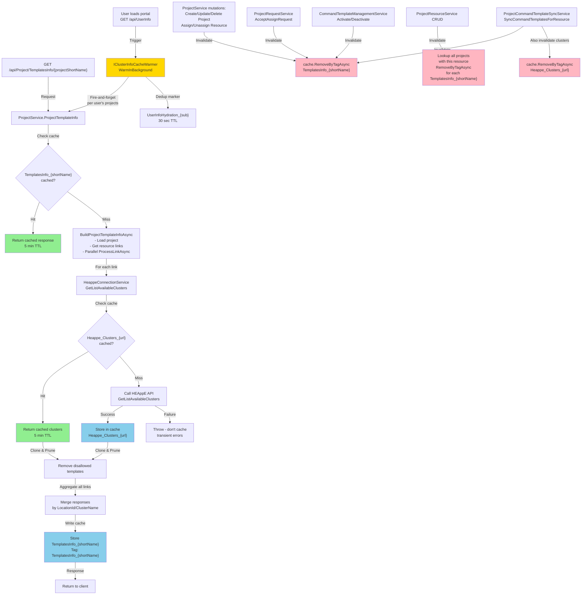
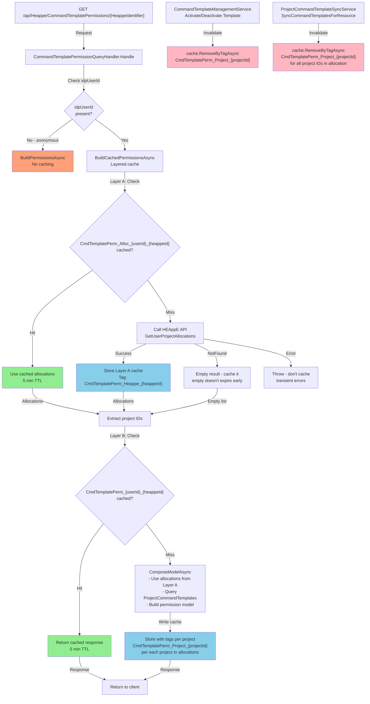
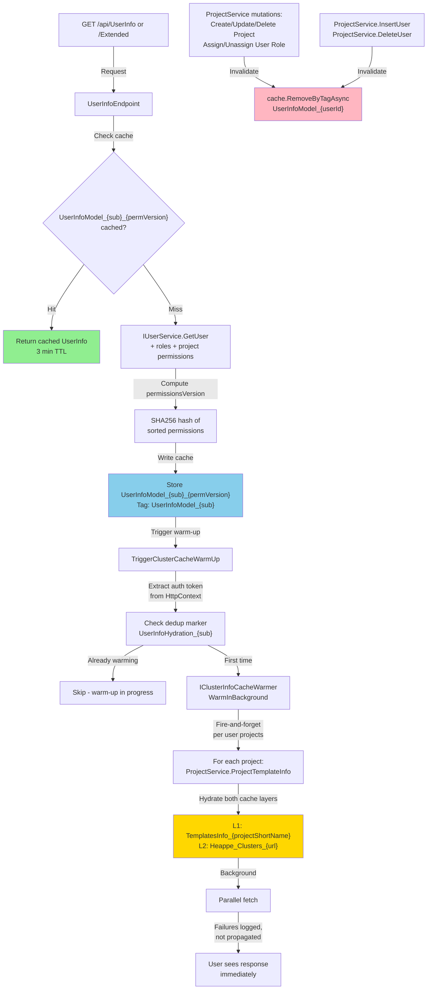

# Hot-path caching (fix/207)

Tři výkonově citlivé endpointy v `src/Core/` cachují svá externí volání do HEAppE pomocí
`HybridCache` (registrace v `src/Core/API/Program.cs`, in-process backing přes
`AddDistributedMemoryCache`, bez Redis). Tento dokument popisuje, co se cachuje, pod jakým klíčem,
s jakým TTL a které akce cache resetují.

## Přehled

| Endpoint | Co se cachuje | TTL | Reset cache |
|---|---|---|---|
| `GET /api/Project/TemplatesInfo/{projectShortName}` | (1) složená odpověď per projekt; (2) surová cluster data per HEAppE URL | 5 min | Změna projektu/resourcu/přiřazení, accept requestu, activate/deactivate template, synchronizace (viz níže) |
| `GET /api/Heappe/CommandTemplatePermissions/{HeappeIdentifier}` | Alokace uživatele + složená odpověď | 5 min | Activate/Deactivate template, synchronizace |
| `GET /api/UserInfo` a `GET /api/UserInfo/Extended` | UserInfo model | 3 min | Změna oprávnění/rolí/projektů uživatele (tag `UserInfoModel_{sub}`) |

Sdílené tagy/klíče jsou v `src/UserOrg.Shared/CacheTags.cs` (`TemplatesInfo(projectShortName)`,
`HeappeClusters(heappeUrl)`).

> **TemplatesInfo a výpadek HEAppE:** selže-li po vyčerpání retry budgetu *každý* dotaz na clustery,
> endpoint vrací **503 Service Unavailable** (`HeappeUnavailableException`), nikoli prázdné `200 []`.
> Částečný výpadek (část instancí odpoví) vrací dostupný snapshot s `200`. Detaily a logování viz
> sekce 1. Selhání volání HEAppE se logují ve `HeappeService` (`Error`),
> `HeappeConnectionService` (`Warning` — včetně rozlišení nedostupné instance vs. mid-rebuild skeletonu)
> a `ProjectService` (`Warning`/`Error`).

---

## Cache flows — Mermaid diagramy

### TemplatesInfo endpoint flow

### CommandTemplatePermissions endpoint flow

### UserInfo endpoint flow with warm-up trigger

---

## 1. TemplatesInfo — `GET /api/Project/TemplatesInfo/{projectShortName}`

**Tok:** `ProjectService.ProjectTemplateInfo` → (response cache) → `BuildProjectTemplateInfoAsync`
→ paralelně `ProcessLinkAsync` (per link) → `HeappeConnectionService.GetListAvailableClusters`
→ (raw cluster cache).

Dvě vrstvy cache:

**Vrstva 1 — složená odpověď per projekt** (`ProjectService.ProjectTemplateInfo`)
- **Klíč i tag:** `TemplatesInfo_{projectShortName}` (`CacheTags.TemplatesInfo`)
- **TTL:** 5 minut; klíč je **token-independentní** (odpověď je dána konfigurací projektu + HEAppE
  daty, ne tokenem). Vyhne se per-request DB dotazům + pruningu, dokud není invalidována.
- **Degradovaný výsledek se necachuje.** `ProcessUrlGroupAsync` selhání HEAppE (null / non-success /
  timeout / výjimka) spolkne a vrátí záznamy `IsAvailable=false`. Aby tato transientní degradace
  neotrávila cache na celých 5 minut (typicky během warm-up burstu po loginu), factory v
  `ProjectTemplateInfo` u degradovaného buildu **vyhodí interní signál** (`DegradedTemplatesInfoSignal`).
  Tím `HybridCache` nic nezapíše (na rozdíl od dřívějšího „zapiš → vzápětí `RemoveAsync`", které
  ponechávalo okno, v němž souběžný request přečetl degradovaný `[]` jako cache-hit), zachová ale
  single-flight — všichni souběžní volající dostanou tentýž signál. Snapshot se do cache nedostane.
  Na cache-hit se factory nespustí, takže zdravý záznam se nikdy neevictuje.
- **Prázdný výsledek se necachuje.** Stejným signálem projde i build, který vyšel prázdný bez degradace
  (žádné linky, vše mimo datové okno, žádná odpovídající alokace/šablona). Login-triggered warm-up jinak
  dokáže vyfotit projekt uprostřed propagace dat (linky/alokace ještě nejsou vidět) a nacachované `[]`
  by tu přechodnou prázdnotu drželo celé TTL — vrstvu 2 přitom mimo synchronizaci nic neinvaliduje.
  Rebuild prázdného snapshotu je levný (katalog clusterů jde dál z vrstvy 2), takže prázdno se vždy
  vyhodnocuje živě a zahojí se prvním voláním po zpropagování dat.
- **Degradovaný build se vrací okamžitě, bez čekání a opakování** (ADR 0073). Endpoint má tvrdý
  60s strop proxy, takže wait-and-rebuild smyčka i `TemplatesInfoRetryPolicy` byly odstraněny;
  hydrataci „přečká" až další volání / login (cache se zahřeje na background warmeru, který se po
  loginu znovu spustí), ne vnitřní smyčka.
- **Rozlišujeme úplný a částečný výpadek** (`BuildProjectTemplateInfoAsync`
  vrací příznak `AllDegraded`):
  - **Úplný výpadek** — selhal *každý* dotaz na clustery (žádná HEAppE instance nevrátila použitelná
    data): místo zavádějícího prázdného `200` se vyhodí `HeappeUnavailableException`, kterou
    `GlobalExceptionHandler` mapuje na **HTTP 503 Service Unavailable**. Klient tak odliší „HEAppE je
    dočasně nedostupné, zkus později" od „projekt nemá žádné šablony". Logováno na úrovni `Error`.
  - **Částečný výpadek** — alespoň jedna instance odpověděla: vrátí se dostupný snapshot s `200`
    (data fungujících instancí + `IsAvailable=false` u těch selhaných). Není to výpadek, je to
    neúplná, ale platná odpověď.
  - Žádné linky / vše mimo datové okno (`results` prázdné) **není** výpadek → standardní `200 []`.

**Vrstva 2 — surová cluster data per HEAppE URL** (`HeappeConnectionService.GetListAvailableClusters`)
- **Klíč i tag:** `Heappe_Clusters_{normalizovaná-HEAppE-URL}` (`CacheTags.HeappeClusters`)
- **TTL:** 5 minut
- Surový seznam clusterů instance je nezávislý na projektu/resourcu; per-projektová logika
  (`GetActiveCommandTemplatesAsync` z DB a pruning přes `PruneDisallowedCommandTemplates`) běží nad
  **klonem** cacheovaných dat.
- **Selhání cluster fetch se propaguje jako `Failure`, ne jako prázdný úspěch.** `GetListAvailableClusters`
  dříve v pruning větvi (projekt má aktivní šablony, `commandTemplates.Count > 0`) četl
  `listAvailableClustersResponse.Value ?? []` bez kontroly `IsSuccess` — selhání instance (down /
  timeout / mid-rebuild) se tak tiše proměnilo v `Success([])`. To obešlo degraded-detekci ve vrstvě 1
  a otrávilo `TemplatesInfo` cache prázdným `[]` na celých 5 minut (projevovalo se jako: data fungují,
  po vypršení cache se vrátí `[]`, a activate/deactivate šablony to „opraví", protože vyčistí cache).
  Nyní se `IsSuccess` kontroluje **před** oběma větvemi a failure se propaguje → vrstva 1 build označí
  za degradovaný a neuloží jej.
- **Sdílení:** infrastrukturní data sdílená napříč uživateli i projekty se stejnou URL; souběžné
  fetch sjednocuje stampede protection `HybridCache`.
- **Selhání HEAppE se necachují** (transientní chyba vyhodí výjimku uvnitř factory).
- **Strukturálně prázdný snapshot se necachuje.** Úspěšná (200) odpověď bez jediného clusteru
  s node typy a projektovými alokacemi je artefakt probíhajícího rebuildu HEAppE (hydratace po
  probuzení) — živá instance vždy nějaké alokace hlásí. Factory ji vyhodí stejně jako nedostupnou
  instanci (`HeappeClustersUnavailableException`), takže neotráví všechny projekty instance na celé
  TTL; nadřazená vrstva ji vidí jako degradovaný build a čeká/opakuje (viz vrstva 1).

**Obejití cache — `?noCache=true`**
- Query parametr `noCache` (default `false`) na `GET /api/Project/TemplatesInfo/{projectShortName}`
  obejde **obě** vrstvy najednou: hodnota se propíše z endpointu přes `ProjectTemplateInfo` →
  `BuildProjectTemplateInfoAsync` → `ProcessUrlGroupAsync` → `HeappeConnectionService.GetListAvailableClusters`.
- V obou vrstvách se při `noCache=true` použijí `HybridCacheEntryOptions` s flagy
  `DisableLocalCacheRead | DisableLocalCacheWrite | DisableDistributedCacheRead | DisableDistributedCacheWrite`,
  tj. **čtení i zápis vypnuty**. Factory tedy vždy běží a HEAppE se dotáže napřímo; výsledek se
  **neuloží** do žádné vrstvy.
- Existující záznamy se **neinvalidují** — je to čistý pass-through pro tento jeden request. Souběžní
  „normální" volající dál dostávají dosud nacachovaný snapshot, dokud nevyexpiruje (na rozdíl od
  invalidace přes `RemoveByTagAsync`).
- Protože vrstva 2 (`Heappe_Clusters_{url}`) je **sdílená napříč projekty**, vypnutý *zápis* zároveň
  zaručuje, že `noCache` request nikdy neobnoví ani neevictuje snapshot jiného projektu.
- **Retry/degraded chování zůstává beze změny** — `noCache` mění pouze cache, ne resilienci; degradovaný
  build se i tak čeká/opakuje a totální výpadek vrací 503 (viz vrstva 1). Vnitřní cache cachuje jen
  úspěchy, takže `noCache` amplifikaci dotazů na HEAppE prakticky nezhoršuje.
- ⚠️ `noCache` odstraňuje 5min škrcení dotazů na HEAppE; není nijak gatováno nad rámec stávajícího RBAC,
  protože nedává schopnost, kterou by volající `TemplatesInfo` neměl (HEAppE se volá i při cache-miss),
  jen mění frekvenci.

**Paralelizace:** odkazy (links) projektu se zpracovávají přes `Task.WhenAll`; sdílené URL se díky
vrstvě 2 deduplikují.

### Akce resetující cache (vrstva 1, tag `TemplatesInfo_{projectShortName}`)

| Akce | Místo | Rozsah |
|---|---|---|
| Create / Update / Delete projektu | `ProjectService.Insert/Update/DeleteProjectAsync` | dotčený projekt |
| Assign / Unassign resourcu k projektu | `ProjectService.Assigned/UnAssignedProjectResourceToProjectAsync` | dotčený projekt |
| Accept requestu (přiřazení resourcu) | `ProjectRequestService.AcceptAssignRequestAsync` → deleguje na `ProjectService.AssignedProjectResourceToProjectAsync` | projekt requestu |
| Create / Update / Delete ProjectResource | `ProjectResourceService` — dohledání přes `ProjectRepository.GetAllWithResources()` | **všechny** projekty referencující resource |
| Insert / Update / Delete přiřazení (HEAPPE_URL atd.) | `ProjectResourceAssignmentService` — ve smyčce u `TriggerSynchronizationForProjectResource` | všechny přiřazené projekty |
| Activate / Deactivate command template | `CommandTemplateManagementService.UpdateCommandTemplateStateAsync` | dotčený projekt |
| Background synchronizace | `ProjectCommandTemplateSyncService.SyncCommandTemplatesForResource` | synchronizovaný projekt |

### Reset vrstvy 2 (surová cluster cache, tag `Heappe_Clusters_{url}`)
- **Synchronizace:** `ProjectCommandTemplateSyncService.SyncCommandTemplatesForResource` po dokončení invaliduje surovou cache pro
  každou dotčenou HEAppE URL (sync stáhl čerstvá HEAppE data).
- **Activate / Deactivate command template:** `CommandTemplateManagementService.UpdateCommandTemplateStateAsync`
  invaliduje instance všech lokací alokace.
- **Vytvoření command template:** `CreateTemplateFlowExtensions` invaliduje dotčenou instanci.
- **Přiřazení resourcu k projektu:** `ProjectService.AssignedProjectResourceToProjectAsync` (obě větve,
  včetně accept requestu, který sem deleguje) invaliduje instance všech HEAppE linků projektu — přiřazení
  je typicky okamžik, kdy se na HEAppE straně objevuje alokace, a katalog stažený o chvíli dřív by ji
  neobsahoval (jinak by ho hojilo jen TTL). Odebrání resourcu tuto evikci nepotřebuje — stale katalog
  nemůže „schovat" neexistenci dat.
- Jinak řízeno TTL (5 min) — HEAppE-side změny mimo tyto akce se projeví po vypršení.

### Rehydratace
- Při volání `GET /api/UserInfo` nebo `GET /api/UserInfo/Extended` se na pozadí (fire-and-forget)
  spustí `IClusterInfoCacheWarmer`, který přes `ProjectTemplateInfo` prohřeje obě vrstvy cache pro
  projekty přihlášeného uživatele. Deduplikace zabraňuje dvojímu spuštění z obou endpointů
  (krátkodobý marker `UserInfoHydration_{sub}`, 30 s).

---

## 2. CommandTemplatePermissions — `GET /api/Heappe/CommandTemplatePermissions/{HeappeIdentifier}`

**Tok:** `CommandTemplatePermissionQueryHandler.Handle` → externí
`IUserorgService.GetUserProjectAllocationsAsync` (HEAppE) + DB dotaz nad `ProjectCommandTemplate`.

Dvouvrstvá cache (klíče/tagy v `HeappeCacheKeys`):

| Vrstva | Co | Klíč | Tag |
|---|---|---|---|
| A — alokace | drahé externí volání alokací uživatele | `CmdTemplatePerm_Alloc_{idpUserId}_{heappeIdentifier}` | `CmdTemplatePerm_Heappe_{heappeIdentifier}` |
| B — odpověď | složený `UserCommandTemplatePermissionModel` | `CmdTemplatePerm_{idpUserId}_{heappeIdentifier}` | `CmdTemplatePerm_Project_{projectId}` (po jednom za každý projekt v alokacích) |

- **TTL:** 5 minut (obě vrstvy)
- **Anonymní volání** (bez `idpUserId`) se necachují.
- Vrstva A drží stav alokací (které projekty/resources uživatel má) — mění se zřídka a typicky se
  synchronizací. Vrstva B drží složenou odpověď včetně stavu command templates z DB; je tagovaná
  per projekt, takže změna stavu template u projektu evictuje záznam **napříč všemi uživateli**
  daného projektu, aniž by se znovu volalo HEAppE pro alokace (ty zůstanou ve vrstvě A).

### Akce resetující cache
Vrstva B invalidace se děje tagem `CmdTemplatePerm_Project_{projectId}`:

| Akce | Místo | Detail |
|---|---|---|
| Aktivace command template | `CommandTemplateManagementService.UpdateCommandTemplateStateAsync` | invaliduje obě vrstvy: PermissionProjectTag + TemplatesInfo |
| Deaktivace command template | `CommandTemplateManagementService.UpdateCommandTemplateStateAsync` | invaliduje obě vrstvy: PermissionProjectTag + TemplatesInfo |
| Background synchronizace | `ProjectCommandTemplateSyncService.SyncCommandTemplatesForResource` | invaliduje obě vrstvy: PermissionProjectTag + TemplatesInfo + HeappeClusters |

> Pozn.: vrstva A (alokace, tag `CmdTemplatePerm_Heappe_{heappeIdentifier}`) nemá explicitní
> invalidaci a je řízena TTL — alokace se nemění změnou stavu template.

---

## 3. UserInfo — `GET /api/UserInfo` a `GET /api/UserInfo/Extended`

**Stav:** již existující cache přes `HybridCache` (`UserInfoEndpoint`). Tato úprava cacheování
neměnila; endpointy navíc slouží jako **trigger rehydratace** cluster cache (viz endpoint 1).

- **Klíč:** `UserInfoModel_{sub}_{permissionsVersion}` resp.
  `UserInfoModel_Extended_{sub}_{permissionsVersion}`, kde `permissionsVersion` je SHA-256 hash
  setříděných oprávnění uživatele.
- **TTL:** 3 minuty
- **Tag:** `UserInfoModel_{sub}` resp. `UserInfoModel_Extended_{sub}`

### Akce resetující cache
Všechny volají `cache.RemoveByTagAsync($"UserInfoModel_{userId}")`:

| Akce | Místo | Detail |
|---|---|---|
| Delete projektu | `ProjectService.DeleteProjectAsync` | uživatelé s rolí v projektu |
| Create přiřazení role uživateli | `ProjectService.AssignedUserToProjectWithRoleAsync` | daný uživatel |
| Update přiřazení role | `ProjectService.EditAssignedUserSystemRole` | daný uživatel |
| Delete přiřazení role | `ProjectService.UnassignUserFromProjectAsync` | daný uživatel |
| Create role uživateli (globální) | `ProjectService.InsertUserAsync` | daný uživatel |
| Delete role uživatele (globální) | `ProjectService.DeleteUserAsync` | daný uživatel |

Změna sady oprávnění navíc mění `permissionsVersion`, což přirozeně vede na nový cache klíč.

---

## 4. Globální reset cache — `DELETE /api/Administration/Cache`

Endpoint pro administratory umožňuje bezodkladně zneplatnit všechny HybridCache záznamy v aktuálním
procesu (Core API) bez čekání na TTL vypršení.

- **HTTP metoda:** DELETE
- **Cesta:** `/api/Administration/Cache`
- **Odpověď:** 200 OK s hláškou "All cache records were reset."
- **Rozsah:** Pouze HybridCache v tomto procesu (Core API instance). Neovlivní:
  - OpenID Connect metadata a klíče pro podepisování v authentication middleware
  - Gateway a její caches (JWKS, interní tokeny, Vault přístupové klíče, oprávnění)
  - Ostatní procesy

**Mechanismus:** Volání `cache.RemoveByTagAsync("*", ct)` zneplatní všechny záznamy (tagované i bez tagů)
v jednom průchodu pomocí globálního wildcard tagu — bez výčtu jednotlivých producentů.
