# Requests Module — Implementation Design

> ⚠️ **Partially stale — read with care.** Parts of this document describe an earlier public API that has
> drifted from the code: `IRequestStrategy.CreateInitialMessage` and the string-based
> `Transition(string completedStateName, JsonDocument?, …)` no longer exist (the real interface uses
> `InitialStepType` + `Transition(StepRequest, StepResult?, IRequestSnapshot)`), the default
> `MaxStepRetries` is `1` (not `3`), and §24 (retention) is spliced into §12 with duplicated content.
> For the **current public API** (now implemented) see [`PublicApiDesign.md`](./PublicApiDesign.md); for canonical terms see
> the library glossary [`WorkflowEngine.Core/CONTEXT.md`](../../../src/Modules/Libraries/WorkflowEngine.Core/CONTEXT.md).
> The **internal mechanics** below (worker loop, leases, idempotency, crash recovery) remain accurate.

## Table of Contents

1. [Purpose and responsibilities](#1-purpose-and-responsibilities)
2. [Hexagonal architecture](#2-hexagonal-architecture)
3. [Typed-state orchestration model](#3-typed-state-orchestration-model)
4. [Strategy placement and packaging](#4-strategy-placement-and-packaging)
5. [Module lifecycle — sequence diagram](#5-module-lifecycle--sequence-diagram)
6. [State machines](#6-state-machines)
7. [Core abstractions](#7-core-abstractions)
8. [Worker mechanics](#8-worker-mechanics)
9. [Concurrency and idempotency guards](#9-concurrency-and-idempotency-guards)
10. [Operator operations — RerunLastStep](#10-operator-operations--rerunlaststep)
11. [Crash recovery](#11-crash-recovery)
12. [Database schema](#12-database-schema)
13. [Ports — driven interfaces](#13-ports--driven-interfaces)
14. [Application service facade — driving port](#14-application-service-facade--driving-port)
15. [Idempotency guarantee](#15-idempotency-guarantee)
16. [Single-step strategy example](#16-single-step-strategy-example)
17. [Multi-step strategy example](#17-multi-step-strategy-example)
18. [REST endpoints](#18-rest-endpoints)
19. [External service integration](#19-external-service-integration)
20. [UI integration](#20-ui-integration)
21. [SOLID mapping](#21-solid-mapping)
22. [Use cases](#22-use-cases)
23. [End-to-end lifetime (all alternatives)](#23-end-to-end-lifetime-all-alternatives)

---

## 1. Purpose and responsibilities

The **Requests module** is a self-contained, hexagonally-structured library. It has no HTTP dependency, no route registrations, and no coupling to any host framework. It is consumed exclusively through its driving port `IRequestApplicationService`.

| Responsibility | Detail |
|---|---|
| **Accept and persist** | Every submitted request is persisted atomically before the caller gets a response — no push is ever silently lost |
| **Idempotency** | Duplicate submissions are detected at the DB boundary and return the original response without side effects |
| **Route to strategy** | Each request carries a strategy name; the module resolves the correct `IRequestStrategy` from DI |
| **Execute typed-state chain** | A `BackgroundService` worker drives steps via `Channel<StepRequest>`; each `IStepHandler<TRequest>` is resolved from DI by request type |
| **State-driven triggering** | Successful completion of a step persists a flow-state transition first; the new state triggers dispatch of the next handler |
| **Track fine-grained state** | Every step transition (`Running → Completed/Failed`) is persisted immediately — callers observe live progress |
| **Store step output** | Data produced by step handlers is persisted to `RequestSteps.Result`|
| **Callback push** | Optional `callbackUrl` receives a HMAC-signed POST after the terminal step |
| **Operator re-run** | Any failed step can be safely re-run by job ID without risk of duplicates or race conditions |
| **Query operations** | Status by id, paged history, aggregated stats — no coupling to delivery mechanism |

---

## 2. Hexagonal architecture

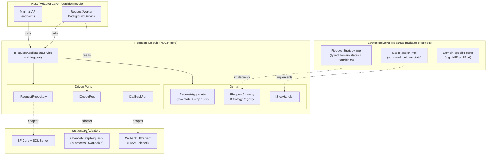

The `IQueuePort` abstraction isolates the in-process `Channel` from the rest of the module. Switching to a persistent broker (RabbitMQ, Azure Service Bus) requires only replacing the `Channel` adapter — no changes to domain, strategy, or application service code.

---

## 3. Typed-state orchestration model

### Key design principle

Each step in a strategy is a **concrete, strongly-typed domain state** represented by a `StepRequest` record — not a generic `Pending/Running/Completed` marker. The strategy defines what states exist, what request type carries the work for each state, and what transitions are valid. Generic execution metadata (`Running`, `Failed`, `RetryScheduled`) exists only at the technical attempt level inside `RequestSteps`.

### Serialization contract (StepRequest + StepResult)

Both the inbound step input and outbound step output are persisted as JSON:

1. `StepRequest` (record) is serialized to `RequestSteps.InputData` before handler execution.
2. `StepResult` (record) is serialized to `RequestSteps.Result` on completion.
3. `RequestSteps.MessageType` stores the concrete request CLR type for deterministic replay.

This gives deterministic crash recovery and re-run because the exact request snapshot is rehydrated from JSON.

### Two distinct layers of state

| Layer | Lives in | Represents | Examples |
|-------|----------|------------|---------|
| **Flow domain state** | `Requests.CurrentState` + strategy | Where the business flow is right now | `ValidatingPayload`, `CallingHEAppE`, `PublishingKeys` |
| **Step execution state** | `RequestSteps.ExecutionStatus` | Technical outcome of a single attempt | `Running`, `Completed`, `Failed`, `RetryScheduled` |

### State-driven trigger contract

The worker does **not** decide what step to run next by inspecting a sequence number. Instead:

1. Handler completes → `StepCompleted` recorded in `RequestSteps`.
2. Worker calls `strategy.Transition(currentState, stepOutput, request)` → returns next typed state or terminal.
3. `FlowStateTransitioned` is persisted atomically with the `StepCompleted` event.
4. **Only after** successful persistence, the next message is written to `IQueuePort`.
5. If the process crashes between step 3 and step 4, startup recovery detects `StepCompleted` with no pending message and re-enqueues.

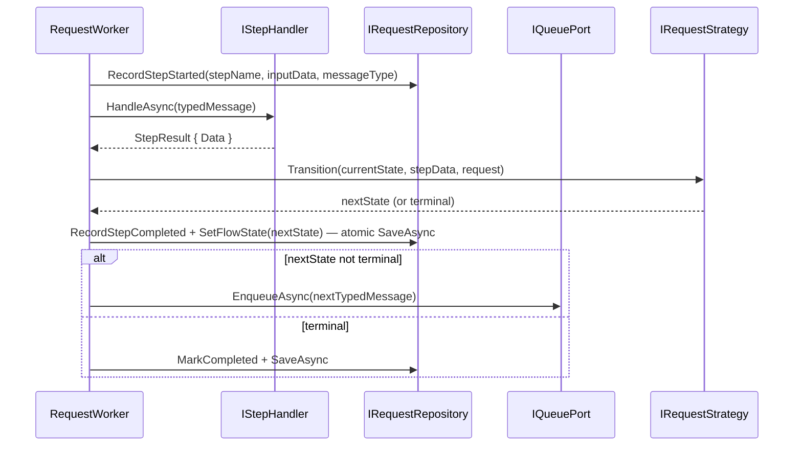

### Strategy transition contract

```c#
interface IRequestStrategy
{
    string Name { get; }

    // Produces the typed initial request on submit.
    StepRequest CreateInitialMessage(RequestAggregate request);

    // Given the completed domain state and its data, returns the next typed request.
    // Returning null signals terminal — flow is done.
    // Throwing InvalidOperationException signals an unexpected state (programming error).
    StepRequest? Transition(string completedStateName, JsonDocument? stepData,
                           RequestAggregate request);
}
```

`Transition` is a pure function — no I/O, no side effects. It is called synchronously inside the worker after `RecordStepCompleted` and before `SaveAsync`. This means the **entire flow definition is a deterministic state machine** concentrated in a single method per strategy.

---

## 4. Strategy placement and packaging

The module defines interfaces (`IRequestStrategy`, `IStepHandler<TRequest>`) but ships zero concrete strategies. Three deployment models are supported:

### Option A — Strategies in the same solution (monolith)

```
solution/
  MyApp.RequestsModule/            ← NuGet-publishable core
  MyApp.Requests.Strategies/       ← concrete strategies + handlers
    HEAppEStrategy.cs
    States/
            ValidatePayloadStepRequest.cs
            CallHEAppEStepRequest.cs
            PublishKeysStepRequest.cs
    Handlers/
      ValidatePayloadHandler.cs
      CallHEAppEHandler.cs
      PublishKeysHandler.cs
    Ports/
      IHEAppEPort.cs
  MyApp.Api/                        ← host: DI wiring, Minimal API endpoints
```

**Best for:** Single service, early-stage product, single team.

### Option B — Strategies as a separate NuGet package (recommended)

```
NuGet: MyPlatform.RequestsModule              ← interfaces, worker, aggregate, ports
NuGet: MyPlatform.Requests.Strategies.HEAppE  ← typed domain states for HEAppE flow
```

```
consuming-service/
  Program.cs                                  ← registers module + strategy packages
  CustomStrategy/
    CustomStrategy.cs                         ← custom strategy if needed
```

**Best for:** Shared platform, multiple consuming services, independent versioning.

### Option C — Plugin model (dynamic loading)

Strategies compiled into assemblies, discovered at runtime from a folder or config path. DI container scans for `IRequestStrategy` implementations.

**Best for:** Multi-tenant platforms with tenant-specific strategy hot-swap. Compile-time type safety is lost — errors surface at runtime.

### Comparison

| Concern | Option A | Option B | Option C |
|---------|:---:|:---:|:---:|
| Reuse across services | ✗ | ✓ | ✓ |
| Compile-time type safety | ✓ | ✓ | ✗ |
| Independent deployment | ✗ | ✗ | ✓ |
| Setup complexity | Low | Medium | High |
| Recommended default | Single service | **Shared platform** | Multi-tenant hot-swap |

### NuGet public surface

```c#
// Exported — consuming code implements these
public abstract record StepRequest(Guid RequestId, string StateName);
public interface IStepHandler<TRequest> where TRequest : StepRequest
{
    Task<StepResult> HandleAsync(TRequest request, CancellationToken ct);
}
public sealed record StepResult(JsonDocument? Data);
public interface IRequestStrategy          { … }
public interface IStrategyRegistry         { … }
public interface IRequestApplicationService{ … }
public interface IRequestRepository        { … }
public interface IQueuePort                { … }
public interface ICallbackPort             { … }

// Internal — never exposed to consuming code
internal class RequestWorker               { … }
internal class RequestAggregate            { … }
internal class StrategyRegistryImpl        { … }
```

```c#
// Host Program.cs
builder.Services.AddRequestsModule(builder.Configuration);
builder.Services.AddSingleton<IRequestStrategy, HEAppEStrategy>();
builder.Services.AddScoped<IStepHandler<ValidatePayloadStepRequest>, ValidatePayloadHandler>();
builder.Services.AddScoped<IStepHandler<CallHEAppEStepRequest>,      CallHEAppEHandler>();
```

---

## 5. Module lifecycle — sequence diagram

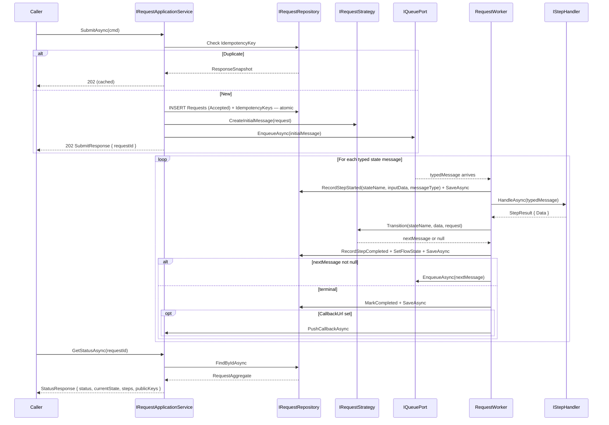

---

## 6. State machines

### 6.1 Flow-level state machine

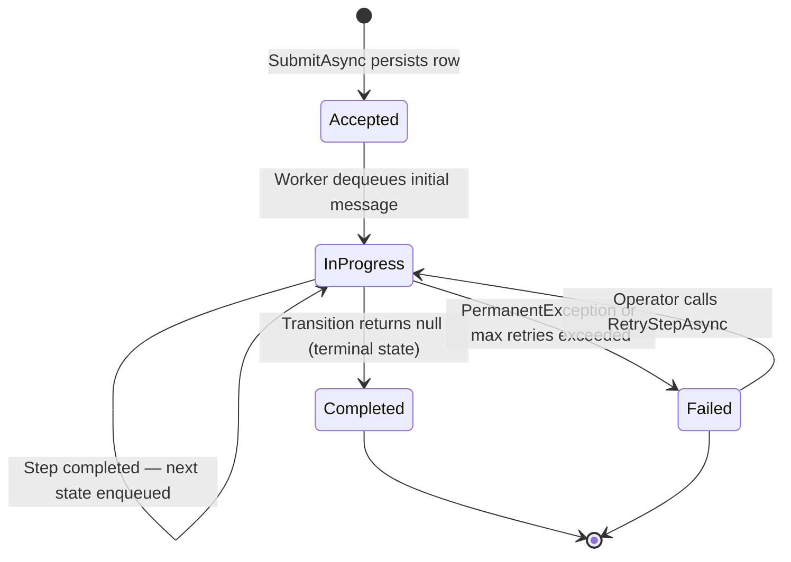

> Note: `RetryScheduled` is a step execution state only (`RequestSteps.ExecutionStatus`). It is intentionally not a flow-level status.

### 6.2 Step execution state machine (per RequestSteps row / attempt)

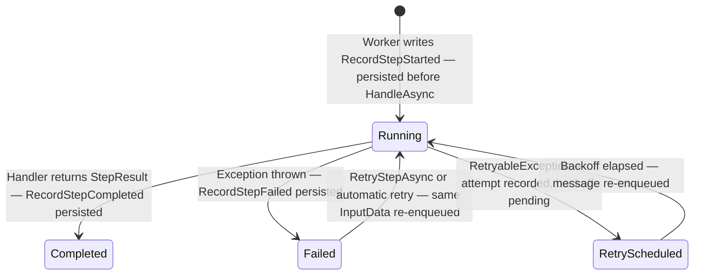

### 6.3 Typed domain state flow (strategy-level — example: HEAppEStrategy)

Each strategy defines its own domain state names. The following is an example for a HEAppE provisioning flow:

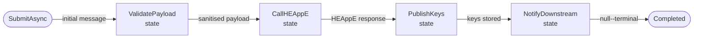

The state names (`ValidatePayload`, `CallHEAppE`, etc.) are string constants defined inside the strategy. They appear in `RequestSteps.StepName` and in `StepRequest.StateName`.

---

## 7. Core abstractions

```c#
/// Typed request — represents exactly one domain state to execute.
/// Each record type carries only the data its handler needs.
/// StateName matches the domain language of the strategy, not generic step names.
abstract record StepRequest(Guid RequestId, string StateName);

/// Pure step handler — performs one unit of work for one domain state.
/// Zero knowledge of flow, Channel, other handlers, or strategy.
interface IStepHandler<TRequest> where TRequest : StepRequest
{
    Task<StepResult> HandleAsync(TRequest request, CancellationToken ct);
}

/// Data returned by any handler. No routing decision — strategy owns that.
record StepResult(JsonDocument? Data);

/// Strategy — owns the complete flow definition as a typed state machine.
interface IRequestStrategy
{
    string Name { get; }

    /// Produces the typed initial request on submit.
    StepRequest CreateInitialMessage(RequestAggregate request);

    /// Pure state transition function. Returns next typed request or null (terminal).
    /// Called synchronously after RecordStepCompleted, before the next EnqueueAsync.
    StepRequest? Transition(string completedStateName, JsonDocument? stepData,
                           RequestAggregate request);
}

/// Resolves strategy by name — all implementations registered in DI.
interface IStrategyRegistry
{
    IRequestStrategy Resolve(string strategyName);
}
```

### Why the strategy owns the transition, not the handler

If handlers returned the next message, the same handler would behave differently depending on the enclosing strategy. This makes handlers strategy-aware, breaks SRP, and prevents reuse across flows. With `Transition` in the strategy:

- Every handler is purely functional — input in, output out.
- The entire flow is expressed as a single deterministic switch in `Transition`.
- Handlers can be shared across multiple strategies without modification.

---

## 8. Worker mechanics

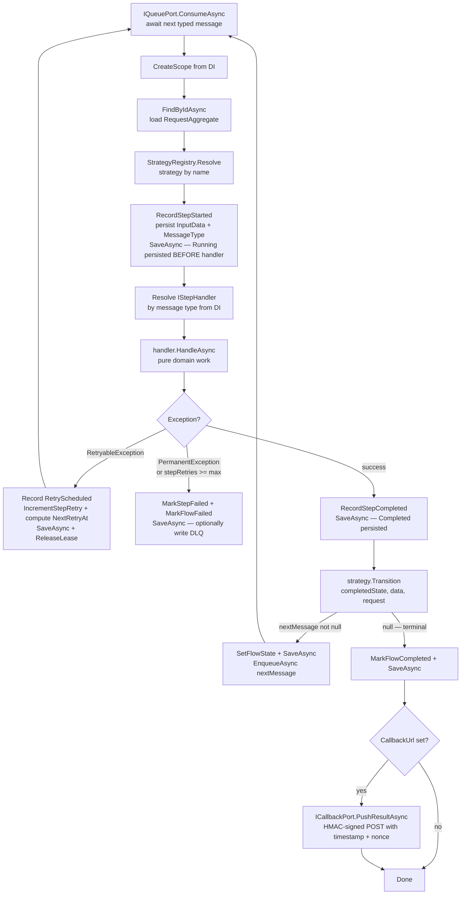

### Worker implementation

```c#
internal class RequestWorker : BackgroundService
{
    private readonly IQueuePort         _queue;
    private readonly IStrategyRegistry  _registry;
    private readonly IServiceScopeFactory _services;
    private readonly ICallbackPort      _callbackPort;

    protected override async Task ExecuteAsync(CancellationToken ct)
    {
        await foreach (var message in _queue.ConsumeAsync(ct))
        {
            using var scope = _services.CreateScope();
            await DispatchAsync(scope.ServiceProvider, message, ct);
        }
    }

    private async Task DispatchAsync(IServiceProvider sp, StepRequest message, CancellationToken ct)
    {
        var repo     = sp.GetRequiredService<IRequestRepository>();
        var request  = await repo.FindByIdAsync(message.RequestId, ct);
        var strategy = _registry.Resolve(request.Strategy);

        // Guard: if this step is already Completed (crash recovery replay), skip execution
        if (request.IsStepCompleted(message.StateName))
        {
            var existing = strategy.Transition(message.StateName,
                               request.GetStepResult(message.StateName), request);
            if (existing is not null)
                await _queue.EnqueueAsync(existing, ct);
            return;
        }

        // Acquire step-level lease before starting (multi-instance guard)
        if (!await repo.TryAcquireStepLeaseAsync(request.RequestId, message.StateName, ct))
            return; // Another instance is already processing this step

        // Persist input before execution — enables deterministic replay
        var inputData = JsonSerializer.SerializeToDocument(message);
        request.RecordStepStarted(message.StateName, inputData,
            message.GetType().AssemblyQualifiedName!);
        await repo.SaveAsync(request, ct);

        try
        {
            var handlerType = typeof(IStepHandler<>).MakeGenericType(message.GetType());
            var result      = await InvokeHandlerAsync(sp.GetRequiredService(handlerType), message, ct);

            // Transition is pure — called before any persistence
            var next = strategy.Transition(message.StateName, result.Data, request);

            // Persist completed step + new flow state atomically
            request.RecordStepCompleted(message.StateName, result.Data);
            if (next is not null)
                request.SetFlowState(next.StateName);
            else
                request.MarkCompleted(result.Data);

            await repo.SaveAsync(request, ct);
            await repo.ReleaseStepLeaseAsync(request.RequestId, message.StateName, ct);

            if (next is not null)
                await _queue.EnqueueAsync(next, ct);
            else if (request.CallbackUrl is not null)
                await _callbackPort.PushResultAsync(
                    request.CallbackUrl, request.RequestId, request.Result!, ct);
        }
        catch (RetryableException ex)
        {
            request.RecordStepRetryScheduled(message.StateName, ex.ToErrorInfo());
            await repo.SaveAsync(request, ct);
            await repo.ReleaseStepLeaseAsync(request.RequestId, message.StateName, ct);
        }
        catch (Exception ex) when (IsPermanentOrExhausted(ex, request, message.StateName))
        {
            request.RecordStepFailed(message.StateName, ex.ToErrorInfo());
            request.MarkFailed(ex.ToErrorInfo());
            await repo.SaveAsync(request, ct);
            await repo.ReleaseStepLeaseAsync(request.RequestId, message.StateName, ct);
        }
    }
}
```

### Retry scheduler (state-driven backoff)

Retry re-enqueue is performed by a dedicated background scanner, not by inline `Task.Delay` inside `RequestWorker`.

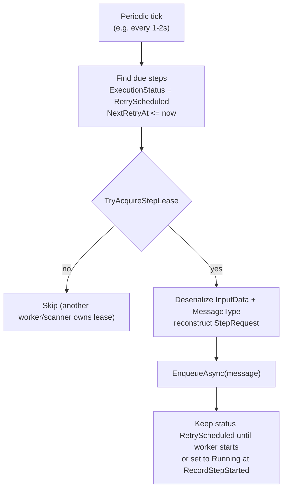

```c#
internal class RetryScheduledScanner : BackgroundService
{
    protected override async Task ExecuteAsync(CancellationToken ct)
    {
        while (!ct.IsCancellationRequested)
        {
            var due = await _repo.FindDueRetryStepsAsync(DateTime.UtcNow, ct);
            foreach (var step in due)
            {
                if (!await _repo.TryAcquireStepLeaseAsync(step.RequestId, step.StepName, ct))
                    continue;

                var message = (StepRequest)JsonSerializer.Deserialize(
                    step.InputData, Type.GetType(step.MessageType)!)!;

                await _queue.EnqueueAsync(message, ct);
            }

            await Task.Delay(TimeSpan.FromSeconds(1), ct);
        }
    }
}
```

---

## 9. Concurrency and idempotency guards

Idempotency alone is not sufficient. It protects against duplicate submissions at the entry point, but does not prevent race conditions during execution. Four guard layers are required:

### Layer 1 — DB-level submission deduplication

`UNIQUE` constraint on `IdempotencyKeys.Key`. The first `INSERT` wins; concurrent duplicates get a unique violation, resolved in application code to return the stored `ResponseSnapshot`.

### Layer 2 — Step-level lease lock

Before writing `RecordStepStarted`, the worker attempts to acquire a lease:

```c#
// RequestSteps columns added for lease support
// LockedBy        varchar(128)   nullable  — worker instance id
// LockedUntil     timestamptz    nullable  — lease expiry
// StepRetries     int            default 0 — per-step retry counter
// NextRetryAt     timestamptz    nullable  — scheduled time for next attempt

Task<bool> TryAcquireStepLeaseAsync(Guid requestId, string stateName, CancellationToken ct);
Task        ReleaseStepLeaseAsync   (Guid requestId, string stateName, CancellationToken ct);
```

Only one worker instance can hold the lease. Lease expiry enables recovery after worker crash without requiring coordination.

### Layer 3 — Optimistic concurrency on RequestAggregate

`Requests` table has a SQL Server `rowversion` column (`RowVersion`). Every `SaveAsync` includes a concurrency predicate against the expected version (or EF Core concurrency token). Concurrent writes to the same aggregate fail with a concurrency exception, which is treated as a retryable error.

### Layer 4 — Handler-level idempotency for external calls

Step handlers must forward `RequestId` as an idempotency token to any external system that supports it. This ensures that if the worker retries a step after a timeout, the external system recognises it as a duplicate and returns the original result without side effects.

```c#
class CallHEAppEHandler : IStepHandler<CallHEAppEStepRequest>
{
    public async Task<StepResult> HandleAsync(CallHEAppEStepRequest msg, CancellationToken ct)
    {
        // RequestId forwarded as idempotency token — HEAppE deduplicates on its side
        var result = await _heappe.CreateOrUpdateResourceAsync(
            idempotencyKey: msg.RequestId.ToString(),
            payload: msg.ValidatedPayload,
            ct: ct);
        return new StepResult(JsonSerializer.SerializeToDocument(result));
    }
}
```

#### When the external service has no idempotency support

If the external API does not support idempotency keys, the handler must use local safeguards to achieve effectively-once behavior:

1. **Outbound operation dedup table**: persist a unique operation fingerprint (`RequestId + StateName + operation hash`) before the external call.
2. **Claim-before-call**: atomically move the outbound operation to `InFlight`; only the winner performs the external write.
3. **Verify-before-write on uncertainty**: after timeout/network errors, do a read check first; only write again if target state is still missing.
4. **Deterministic business key**: use a stable external key when available so duplicate creates return conflict/no-op.
5. **Compensation/manual reconciliation path**: for APIs where duplicates cannot be prevented or detected reliably.

This does not provide strict exactly-once side effects, but provides robust effectively-once behavior for retries and crash recovery.

### Guard layer summary

| Scenario | Guard | Mechanism |
|----------|-------|-----------|
| Duplicate `SubmitAsync` call | DB UNIQUE on idempotency key | Atomic INSERT + ResponseSnapshot |
| Two workers dequeue same message | Step lease lock | `TryAcquireStepLeaseAsync` before `RecordStepStarted` |
| Concurrent state transitions | Optimistic concurrency | RowVersion on `Requests` |
| Handler retry creates duplicate resource | External idempotency token OR local outbound dedup + verify-before-write | `RequestId` forwarded when supported, otherwise claim-check + dedup table |
| Worker crash leaves stale lease | Lease expiry + startup scan | TTL on `LockedUntil` |

---

## 10. Operator operations — RerunLastStep

### Purpose

Given a `jobId` (= `RequestId`), restart the last step of the flow without interaction from the original caller. This is the primary operator recovery action for failed flows.

### Safe conditions for rerun

| Current step execution state | Rerun allowed? | Reason |
|------------------------------|:--------------:|--------|
| `Running` with active lease  | No — returns 409 | Step is actively being processed |
| `Running` with expired lease | Yes — treated as Failed | Worker crashed; lease expired |
| `RetryScheduled`             | Yes — cancels backoff | Operator forces immediate retry |
| `Failed`                     | Yes — standard case | Primary rerun scenario |
| `Completed`                  | No (default) | Already succeeded; rerun would duplicate side effects |
| `Completed` + force flag     | Yes (elevated role only) | Emergency recovery; audit entry required |

### Sequence

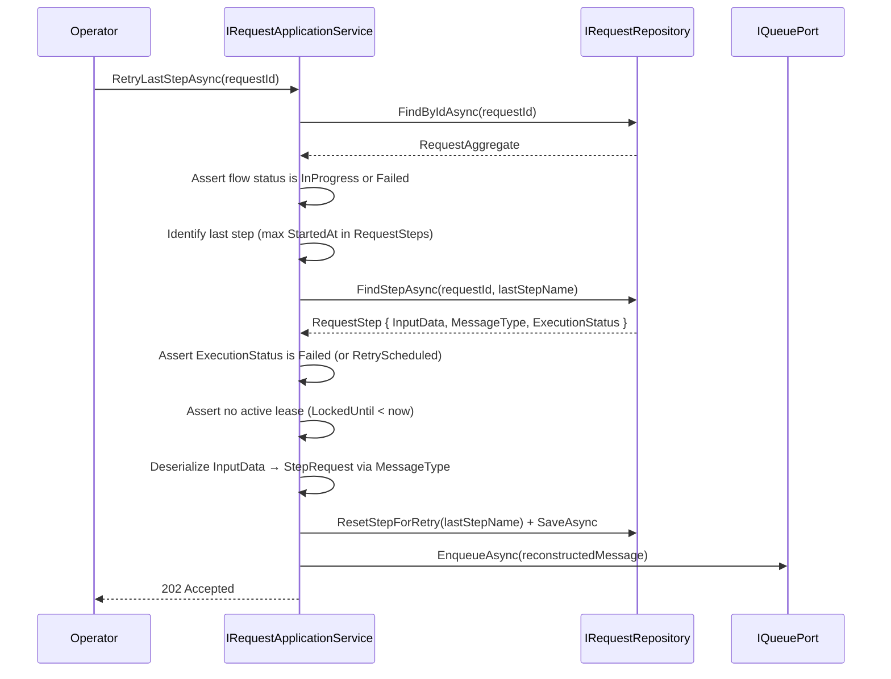

### Application service implementation

```c#
// IRequestApplicationService — operator operations
Task RetryLastStepAsync (Guid requestId, CancellationToken ct);
Task RetryStepAsync     (Guid requestId, string stateName, CancellationToken ct);
Task MarkFlowFailedAsync(Guid requestId, string errorCode, string errorMessage, CancellationToken ct);
```

`RetryLastStepAsync` internal steps:
1. Load `RequestAggregate`; assert status is `InProgress` or `Failed`.
2. Find last step: `RequestSteps` row with `MAX(StartedAt)` for this `RequestId`.
3. Load full `RequestStep` row via `FindStepAsync`.
4. Assert `ExecutionStatus` is `Failed` or `RetryScheduled`.
5. Assert no active lease: `LockedUntil IS NULL OR LockedUntil < now`.
6. Deserialize: `JsonSerializer.Deserialize(step.InputData, Type.GetType(step.MessageType)!)`.
7. Call `request.ResetStepForRetry(stateName)` — clears terminal error fields and retry schedule metadata for a new attempt.
8. `SaveAsync` with optimistic concurrency.
9. `EnqueueAsync(reconstructedMessage)` — worker picks up and processes normally.

---

## 11. Crash recovery

If the process crashes after `RecordStepStarted` but before `RecordStepCompleted`:

1. On startup, `RequestWorker` runs a recovery scan: finds all `RequestSteps` rows in status `Running` with `LockedUntil < now` (expired lease).
2. For each row: reconstructs the `StepRequest` from `InputData` + `MessageType`.
3. Calls `ResetStepForRetry` and re-enqueues the message.
4. Worker processes it normally; `IsStepCompleted` guard ensures already-completed steps are skipped on replay.

```c#
internal class RequestWorkerStartupRecovery : IHostedService
{
    public async Task StartAsync(CancellationToken ct)
    {
        var stuckSteps = await _repo.FindStuckStepsAsync(leasedBefore: DateTime.UtcNow, ct);
        foreach (var step in stuckSteps)
        {
            var message = JsonSerializer.Deserialize(
                step.InputData, Type.GetType(step.MessageType)!) as StepRequest;
            await _repo.ResetStepForRetry(step.RequestId, step.StepName, ct);
            await _queue.EnqueueAsync(message!, ct);
        }
    }
}
```

---

## 12. Database schema

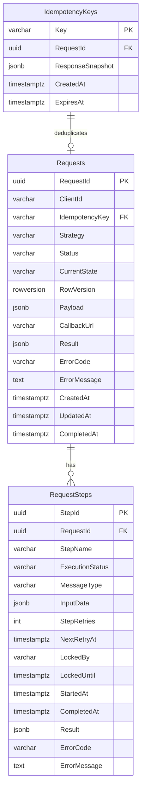


### Requests table

| Column | Type | Notes |
|--------|------|-------|
| RequestId | UUID PK | Server-generated |
| ClientId | varchar(256) | nullable |
| IdempotencyKey | varchar(512) | nullable, FK → IdempotencyKeys.Key |
| Strategy | varchar(64) | Registered strategy name |
| Status | varchar(32) | `Accepted` / `InProgress` / `Completed` / `Failed` |
| CurrentState | varchar(128) | Current domain state name as defined by the strategy |
| RowVersion | rowversion | SQL Server concurrency token; updated automatically on every row write |
| Payload | jsonb | Original raw input |
| CallbackUrl | varchar(2048) | nullable |
| Result | jsonb | nullable; aggregated result on completion |
| ErrorCode | varchar(128) | nullable |
| ErrorMessage | text | nullable |
| CreatedAt / UpdatedAt / CompletedAt | timestamptz | lifecycle timestamps |

Indexes: `(Status)`, `(ClientId, CreatedAt DESC)`, `(UpdatedAt DESC)`

---

## 24. Data retention, cleanup and archiving

To prevent unbounded database growth and comply with data retention policies, the module supports configurable cleanup and archival of request/step data.

### Retention policy


### Cleanup process

1. **Scheduled job**: A background process (e.g. nightly) scans for `Requests` and `RequestSteps` older than the configured retention period or exceeding the max count.
2. **Cascade delete**: Deleting a `Requests` row should cascade to all related `RequestSteps` and `IdempotencyKeys`.
3. **Archival (optional)**: Before deletion, data can be copied to an archive table or exported for compliance.
4. **Configuration**: Retention and archival settings are provided in app configuration (e.g. `appsettings.json`):

```json
{
    "RequestsModule": {
        "RequestsRetentionDays": 30,
        "MaxCompletedRequestsPerClient": 1000,
        "EnableArchival": true
    }
}
```

### Example cleanup SQL

```sql
DELETE FROM Requests WHERE Status = 'Completed' AND CompletedAt < DATEADD(day, -@RetentionDays, GETUTCDATE());

INSERT INTO RequestsArchive SELECT * FROM Requests WHERE Status = 'Completed' AND CompletedAt < DATEADD(day, -@RetentionDays, GETUTCDATE());
```

### Notes
To prevent unbounded database growth and comply with data retention policies, the module supports configurable cleanup and archival of request/step data.

### Retention policy

- **Configurable retention period**: Set via configuration (e.g. `RequestsRetentionDays`, default 30 days).
- **Max record count**: Optionally, set a maximum number of records to keep (e.g. keep only the last N completed requests per client or globally).
- **Archival**: Optionally, move old data to an archive table or external storage before deletion.

### Implementation design

#### 1. Scheduled cleanup job
A background service (e.g. `RequestsCleanupService : BackgroundService`) runs periodically (e.g. nightly or every N hours). It:
- Loads retention/archival settings from configuration.
- Selects `Requests` (and related `RequestSteps`, `IdempotencyKeys`) older than the retention period or exceeding the max count.
- If archival is enabled, copies data to archive tables or exports to external storage before deletion.
- Deletes expired/old data from the main tables.

#### 2. Cascade delete
The database schema should enforce `ON DELETE CASCADE` for `RequestSteps` and `IdempotencyKeys` referencing `Requests`, so deleting a `Requests` row automatically removes all related data.

#### 3. Archival
If enabled, the cleanup job first copies data to archive tables (e.g. `RequestsArchive`, `RequestStepsArchive`, `IdempotencyKeysArchive`) or exports to a file/storage (e.g. CSV, blob storage) before deletion. Archive tables should mirror the schema of the main tables.

#### 4. Configuration
Retention and archival settings are provided in app configuration (e.g. `appsettings.json`):

```json
{
  "RequestsModule": {
    "RequestsRetentionDays": 30,
    "EnableArchival": true,
    "CleanupIntervalHours": 24,
    "MaxCompletedRequestsPerClient": 1000
  }
}
```

#### 5. Example implementation (C#)

```csharp
public class RequestsCleanupService : BackgroundService
{
    private readonly IServiceProvider _sp;
    private readonly IConfiguration _cfg;
    public RequestsCleanupService(IServiceProvider sp, IConfiguration cfg) { _sp = sp; _cfg = cfg; }

    protected override async Task ExecuteAsync(CancellationToken ct)
    {
        var retentionDays = _cfg.GetValue<int>("RequestsModule:RequestsRetentionDays", 30);
        var enableArchival = _cfg.GetValue<bool>("RequestsModule:EnableArchival", false);
        var interval = TimeSpan.FromHours(_cfg.GetValue<int>("RequestsModule:CleanupIntervalHours", 24));
        while (!ct.IsCancellationRequested)
        {
            using var scope = _sp.CreateScope();
            var db = scope.ServiceProvider.GetRequiredService<MyDbContext>();
            var cutoff = DateTime.UtcNow.AddDays(-retentionDays);

            // Optionally archive
            if (enableArchival)
            {
                var toArchive = db.Requests.Where(r => r.Status == "Completed" && r.CompletedAt < cutoff).ToList();
                db.RequestsArchive.AddRange(toArchive.Select(r => new RequestsArchive(r)));
                // ...repeat for RequestSteps, IdempotencyKeys
            }

            // Delete old requests (cascades to steps/keys)
            db.Requests.RemoveRange(db.Requests.Where(r => r.Status == "Completed" && r.CompletedAt < cutoff));
            await db.SaveChangesAsync(ct);

            await Task.Delay(interval, ct);
        }
    }
}
```

#### 6. Example cleanup SQL

```sql
-- Delete completed requests older than retention period
DELETE FROM Requests WHERE Status = 'Completed' AND CompletedAt < DATEADD(day, -@RetentionDays, GETUTCDATE());

-- Optionally, archive before delete
INSERT INTO RequestsArchive SELECT * FROM Requests WHERE Status = 'Completed' AND CompletedAt < DATEADD(day, -@RetentionDays, GETUTCDATE());
-- ...then delete as above
```

#### 7. Safety and compliance notes
- Cleanup/archival jobs should be monitored and have error logging/alerting.
- For compliance, ensure audit logs or exports are retained as required by your policy.
- Archive tables should be protected (e.g. access control, encryption at rest).
- Test cleanup/archival on a staging environment before enabling in production.

The same retention logic applies to `RequestSteps` and `IdempotencyKeys`.

### RequestSteps table

| Column | Type | Notes |
|--------|------|-------|
| StepId | UUID PK | |
| RequestId | UUID FK | → Requests |
| StepName | varchar(128) | Domain state name, e.g. `"CallHEAppE"` |
| ExecutionStatus | varchar(32) | `Running` / `Completed` / `Failed` / `RetryScheduled` |
| MessageType | varchar(512) | Assembly-qualified type name; used to reconstruct message on retry |
| InputData | jsonb | Serialized `StepRequest`; persisted before `HandleAsync` |
| StepRetries | int | default 0; per-step retry counter |
| NextRetryAt | timestamptz | nullable; scheduled time for the next attempt |
| LockedBy | varchar(128) | nullable; worker instance id holding the lease |
| LockedUntil | timestamptz | nullable; lease expiry |
| StartedAt | timestamptz | Set by `RecordStepStarted` |
| CompletedAt | timestamptz | Set by `RecordStepCompleted` |
| Result | jsonb | nullable; JSON from `StepResult.Data` |
| ErrorCode / ErrorMessage | varchar / text | nullable |

Indexes: `(RequestId)`, `(ExecutionStatus, LockedUntil)` (for recovery scan)

### IdempotencyKeys table

| Column | Type | Notes |
|--------|------|-------|
| Key | varchar(512) PK | UNIQUE; client-provided `Idempotency-Key` header |
| RequestId | UUID FK | → Requests |
| ResponseSnapshot | jsonb | Stored 202 response body |
| CreatedAt / ExpiresAt | timestamptz | TTL-based cleanup (default 24h) |

---

## 13. Ports — driven interfaces

```c#
interface IRequestRepository
{
    Task SaveAsync(RequestAggregate request, CancellationToken ct);
    Task<RequestAggregate?>  FindByIdAsync (Guid requestId, CancellationToken ct);
    Task<RequestStep?>       FindStepAsync (Guid requestId, string stateName, CancellationToken ct);
    Task<IReadOnlyList<RequestStep>> FindStuckStepsAsync(DateTime leasedBefore, CancellationToken ct);
    Task<IReadOnlyList<RequestStep>> FindDueRetryStepsAsync(DateTime now, CancellationToken ct);

    Task<bool> TryAcquireStepLeaseAsync(Guid requestId, string stateName, CancellationToken ct);
    Task       ReleaseStepLeaseAsync   (Guid requestId, string stateName, CancellationToken ct);
    Task       ResetStepForRetry       (Guid requestId, string stateName, CancellationToken ct);

    Task<PagedResult<RequestSummaryItem>> ListAsync    (RequestFilter filter, CancellationToken ct);
    Task<RequestStats>                    GetStatsAsync(StatsFilter filter, CancellationToken ct);
}

interface IQueuePort
{
    Task EnqueueAsync(StepRequest request, CancellationToken ct);
    IAsyncEnumerable<StepRequest> ConsumeAsync(CancellationToken ct);
}

/// <summary>
/// Generic callback port for terminal request notification.
/// The implementation decides how and where to deliver the callback (HTTP, message bus, event, etc.).
/// </summary>
interface ICallbackPort
{
    /// <summary>
    /// Pushes the result of a completed request to a callback target.
    /// The callbackTarget parameter is an opaque identifier (e.g. URL, queue name, topic, etc.)
    /// understood by the implementation.
    /// </summary>
    Task PushResultAsync(string callbackTarget, Guid requestId, JsonDocument result, CancellationToken ct);
}
```

---

## 14. Application service facade — driving port

```c#
interface IRequestApplicationService
{
    // Submission — idempotent
    Task<SubmitResponse> SubmitAsync(SubmitCommand cmd, CancellationToken ct);

    // Query
    Task<StatusResponse>                  GetStatusAsync (Guid requestId,      CancellationToken ct);
    Task<PagedResult<RequestSummaryItem>> ListAsync      (RequestFilter filter, CancellationToken ct);
    Task<RequestStats>                    GetStatsAsync  (StatsFilter filter,   CancellationToken ct);

    // Operator — retry last failed step by job id
    Task RetryLastStepAsync (Guid requestId, CancellationToken ct);

    // Operator — retry a specific named step (must be Failed)
    Task RetryStepAsync     (Guid requestId, string stateName, CancellationToken ct);

    // Operator — administratively close a stuck flow
    Task MarkFlowFailedAsync(Guid requestId, string errorCode, string errorMessage, CancellationToken ct);
}
```

### SubmitAsync internal flow

1. Validate `cmd.Payload` structure (boundary validation only).
2. Check idempotency key — return cached `ResponseSnapshot` if duplicate.
3. Create `RequestAggregate` (status `Accepted`), insert `Requests` row.
4. Insert `IdempotencyKeys` row **atomically** in the same transaction.
5. Call `strategy.CreateInitialMessage(request)` → write to `IQueuePort`.
6. Return `SubmitResponse { RequestId, Status = "accepted" }`.

### RetryLastStepAsync internal flow

1. Load `RequestAggregate`; assert status is `InProgress` or `Failed`.
2. Select `RequestStep` with `MAX(StartedAt)` for this `RequestId`.
3. Assert `ExecutionStatus` is `Failed` or `RetryScheduled`.
4. Assert no active lease: `LockedUntil IS NULL OR LockedUntil < now`.
5. Deserialize `InputData` using `Type.GetType(step.MessageType)`.
6. Call `request.ResetStepForRetry(stateName)` and `SaveAsync`.
7. `EnqueueAsync(reconstructedMessage)`.

---

## 15. Idempotency guarantee

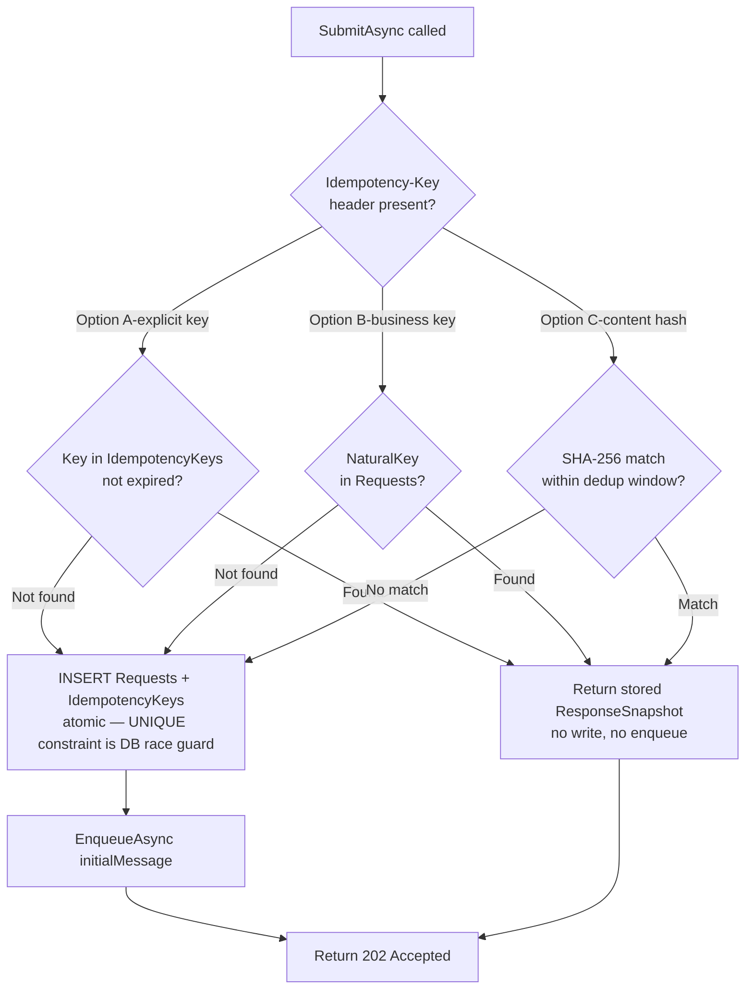

| Option | Best for | Race guard |
|--------|----------|-----------|
| **A** — explicit `Idempotency-Key` header | Clients under your control | `UNIQUE(IdempotencyKeys.Key)` |
| **B** — business natural key | Stable payload identity exists | `UNIQUE(Requests.NaturalKey)` |
| **C** — `SHA-256(clientId + payload)` with time window | Legacy clients | Deduplication window only (10–30s) |

Worker-side guard (always active): before executing a step the worker calls `IsStepCompleted` — if the step is already `Completed` in DB, it is skipped and the next state is dispatched. This ensures crash recovery never re-executes completed steps.

---

## 16. Single-step strategy example

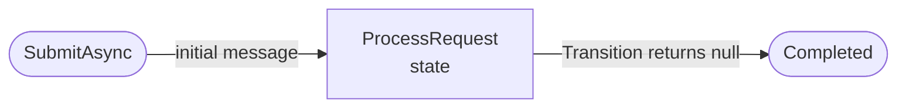

```c#
record ProcessRequestStepRequest(Guid RequestId, JsonDocument Payload)
    : StepRequest(RequestId, "ProcessRequest");

class ProcessRequestHandler : IStepHandler<ProcessRequestStepRequest>
{
    private readonly IMyServicePort _service;
    public ProcessRequestHandler(IMyServicePort service) => _service = service;

    public async Task<StepResult> HandleAsync(ProcessRequestStepRequest msg, CancellationToken ct)
    {
        var result = await _service.PerformOperationAsync(msg.RequestId, msg.Payload, ct);
        return new StepResult(JsonSerializer.SerializeToDocument(result));
    }
}

class SingleStepStrategy : IRequestStrategy
{
    public string Name => "single-step";

    public StepRequest CreateInitialMessage(RequestAggregate r)
        => new ProcessRequestStepRequest(r.RequestId, r.Payload);

    public StepRequest? Transition(string completedState, JsonDocument? data, RequestAggregate r)
        => null; // always terminal
}

// DI
services.AddSingleton<IRequestStrategy, SingleStepStrategy>();
services.AddScoped<IStepHandler<ProcessRequestStepRequest>, ProcessRequestHandler>();
```

---

## 17. Multi-step strategy example


### Typed state messages

```c#
record ValidatePayloadStepRequest(Guid RequestId, JsonDocument Payload)
    : StepRequest(RequestId, "ValidatePayload");

record CallHEAppEStepRequest(Guid RequestId, JsonDocument ValidatedPayload)
    : StepRequest(RequestId, "CallHEAppE");

record PublishKeysStepRequest(Guid RequestId, JsonDocument HEAppEResult)
    : StepRequest(RequestId, "PublishKeys");

record NotifyDownstreamStepRequest(Guid RequestId, JsonDocument PublishedKeys)
    : StepRequest(RequestId, "NotifyDownstream");
```

### Pure handlers

```c#
class ValidatePayloadHandler : IStepHandler<ValidatePayloadStepRequest>
{
    public async Task<StepResult> HandleAsync(ValidatePayloadStepRequest msg, CancellationToken ct)
    {
        var sanitised = await _validator.ValidateAndSanitiseAsync(msg.Payload, ct);
        return new StepResult(JsonSerializer.SerializeToDocument(sanitised));
    }
}

class CallHEAppEHandler : IStepHandler<CallHEAppEStepRequest>
{
    private readonly IHEAppEPort _heappe;
    public CallHEAppEHandler(IHEAppEPort heappe) => _heappe = heappe;

    public async Task<StepResult> HandleAsync(CallHEAppEStepRequest msg, CancellationToken ct)
    {
        // RequestId forwarded as idempotency token — prevents duplicate resource creation on retry
        var result = await _heappe.CreateOrUpdateResourceAsync(
            idempotencyToken: msg.RequestId.ToString(),
            payload: msg.ValidatedPayload,
            ct: ct);
        return new StepResult(JsonSerializer.SerializeToDocument(result));
    }
}

class PublishKeysHandler : IStepHandler<PublishKeysStepRequest>
{
    public async Task<StepResult> HandleAsync(PublishKeysStepRequest msg, CancellationToken ct)
    {
        var keys = await _keyStore.PublishAsync(msg.RequestId, msg.HEAppEResult, ct);
        return new StepResult(JsonSerializer.SerializeToDocument(keys));
    }
}

class NotifyDownstreamHandler : IStepHandler<NotifyDownstreamStepRequest>
{
    public async Task<StepResult> HandleAsync(NotifyDownstreamStepRequest msg, CancellationToken ct)
    {
        await _bus.PublishAsync(new ResourceProvisionedEvent(msg.RequestId, msg.PublishedKeys), ct);
        return new StepResult(Data: null);
    }
}
```

### Strategy — entire flow in one Transition switch

```c#
class HEAppEStrategy : IRequestStrategy
{
    public string Name => "heappe-provision";

    public StepRequest CreateInitialMessage(RequestAggregate r)
        => new ValidatePayloadStepRequest(r.RequestId, r.Payload);

    public StepRequest? Transition(string completedState, JsonDocument? data, RequestAggregate r)
        => completedState switch
        {
            "ValidatePayload"   => new CallHEAppEStepRequest(r.RequestId, data!),
            "CallHEAppE"        => new PublishKeysStepRequest(r.RequestId, data!),
            "PublishKeys"       => new NotifyDownstreamStepRequest(r.RequestId, data!),
            "NotifyDownstream"  => null,
            _ => throw new InvalidOperationException($"Unexpected state: {completedState}")
        };
}
```

### DI registration

```c#
services.AddSingleton<IRequestStrategy, HEAppEStrategy>();
services.AddScoped<IStepHandler<ValidatePayloadStepRequest>,   ValidatePayloadHandler>();
services.AddScoped<IStepHandler<CallHEAppEStepRequest>,        CallHEAppEHandler>();
services.AddScoped<IStepHandler<PublishKeysStepRequest>,       PublishKeysHandler>();
services.AddScoped<IStepHandler<NotifyDownstreamStepRequest>,  NotifyDownstreamHandler>();
```

### Observable progression via GET /requests/{id}

```json
{
  "requestId": "3fa85f64-5717-4562-b3fc-2c963f66afa6",
  "status": "in_progress",
  "currentState": "CallHEAppE",
  "strategy": "heappe-provision",
  "steps": [
    { "stateName": "ValidatePayload",   "executionStatus": "Completed", "completedAt": "..." },
    { "stateName": "CallHEAppE",        "executionStatus": "Running",   "startedAt":   "..." },
        { "stateName": "PublishKeys",       "executionStatus": "RetryScheduled", "nextRetryAt": "..." }
  ]
}
```

---

## 18. REST endpoints

The module has no HTTP knowledge. The Minimal API project maps routes to `IRequestApplicationService`:

| Method | Path | Module call | Response |
|--------|------|-------------|---------|
| `POST` | `/requests` | `SubmitAsync(cmd)` | 202 + `Location: /requests/{id}` |
| `GET` | `/requests` | `ListAsync(filter)` | 200 paged list |
| `GET` | `/requests/{id}` | `GetStatusAsync(id)` | 200 or 404 |
| `GET` | `/requests/summary` | `GetStatsAsync(filter)` | 200 stats |
| `POST` | `/requests/{id}/retry-last-step` | `RetryLastStepAsync(id)` | 202 or 409 |
| `POST` | `/requests/{id}/steps/{state}/retry` | `RetryStepAsync(id, state)` | 202 or 409 |
| `POST` | `/requests/{id}/mark-failed` | `MarkFlowFailedAsync(id, ...)` | 200 or 404 |

---

## 19. External service integration

Pattern for integrating an external service (e.g. HEAppE) as a typed step:

1. Define a driven port interface in the consuming layer: `IHEAppEPort`.
2. Implement with an infrastructure adapter (`HttpClient` + Polly for resilience).
3. Inject into the step handler via constructor injection.
4. Forward `RequestId` as idempotency token — prevents duplicate resource creation on retry.
5. `5xx` / timeout → `throw new RetryableException(...)` → worker records `RetryScheduled`; scanner re-enqueues after `NextRetryAt`.
6. `4xx` → `throw new PermanentException(...)` → worker marks flow `Failed` immediately.

```c#
interface IHEAppEPort
{
    Task<HEAppEResourceResult> CreateOrUpdateResourceAsync(
        string idempotencyToken,
        JsonDocument payload,
        CancellationToken ct);
}
```

Backoff limits must be configured explicitly:

```json
{
  "RequestsModule": {
        "MaxStepRetries": 1,
    "MaxBackoffSeconds": 300,
    "StepLeaseSeconds": 120,
    "IdempotencyKeyTtlHours": 24
  }
}
```

`MaxStepRetries` is configurable, default is `1` (one retry after the first failed attempt, so maximum two total attempts per step).

---

## 20. UI integration

- **Submit**: `POST /requests` → persist `requestId` from response body.
- **Polling**: `GET /requests/{id}` every 1s; back off to 5–10s once `in_progress`. Stop on `completed` or `failed`.
- **Step visibility**: `steps[]` array shows `currentState` and per-step `executionStatus` — enables granular progress display and retry triggering.
- **Operator retry**: `POST /requests/{id}/retry-last-step` — 202 if accepted, 409 if step is still running.
- **History**: `GET /requests?clientId=X&status=completed&page=1&pageSize=20`.
- **Dashboard**: `GET /requests/summary?from=...&to=...&strategy=heappe-provision`.

---

## 21. SOLID mapping

| Principle | Application |
|-----------|-------------|
| **SRP** | `RequestAggregate` — state transitions only. `IStepHandler<T>` — one work unit for one domain state. `RequestWorker` — dispatch loop only. `IRequestStrategy` — flow definition and typed transitions only. |
| **OCP** | New strategies and handlers added via DI registration — no existing classes modified. |
| **LSP** | All `IStepHandler<T>` and `IRequestStrategy` implementations are fully substitutable by contract. |
| **ISP** | `IRequestRepository`, `IQueuePort`, `ICallbackPort` — one interface per concern. Domain-specific ports (e.g. `IHEAppEPort`) defined in the consuming layer. |
| **DIP** | Domain and application layers depend only on port interfaces. Adapters (EF Core, `Channel`, `HttpClient`) live in the infrastructure layer and are never referenced by domain code. |

---

## 22. Use cases

| # | Trigger | Outcome |
|---|---------|---------| 
| UC-01 | Submit, single-state strategy | Accepted → one handler → Completed |
| UC-02 | Submit, multi-state strategy | Accepted → typed state chain → Completed |
| UC-03 | Duplicate submission (same idempotency key) | `ResponseSnapshot` returned, nothing enqueued |
| UC-04 | Invalid payload | Validation error, no DB write |
| UC-05 | Worker: all states succeed | All `RequestSteps` Completed, `Requests.Status = Completed` |
| UC-06 | Handler throws `RetryableException` | `RetryScheduled` recorded, step is re-enqueued by scanner after `NextRetryAt` |
| UC-07 | `StepRetries >= max` | Configured retry limit exhausted (default `1`) → `MarkFailed`, optional DLQ entry |
| UC-08 | Process crash mid-step | Expired lease detected on startup; `InputData` replayed; completed states skipped |
| UC-09 | External service 5xx / timeout | Treated as UC-06; `RequestId` forwarded as idempotency token to external service |
| UC-10 | External service permanent failure (4xx) | `PermanentException` → `MarkFailed` immediately |
| UC-11 | `GetStatusAsync` | Returns status, `currentState`, steps with `executionStatus`, public keys, result/error |
| UC-12 | `ListAsync` | Paged history per client/status/strategy/time range |
| UC-13 | `GetStatsAsync` | Totals + `lastProcessedAt` + by-strategy breakdown |
| UC-14 | Callback push | HMAC-signed POST with timestamp + nonce to `callbackUrl` after terminal state |
| UC-15 | Idempotency TTL cleanup | Expired `IdempotencyKeys` rows deleted by scheduled job |
| UC-16 | Operator retries last failed step | `RetryLastStepAsync` reconstructs message from `InputData + MessageType`, re-enqueues |
| UC-17 | Operator retries specific named step | `RetryStepAsync(id, stateName)` — same flow as UC-16 but for an explicitly named state |
| UC-18 | Operator marks flow as failed | `MarkFlowFailedAsync` closes request with operator-supplied error; no retry |
| UC-19 | Concurrent `RetryLastStepAsync` calls for same job | Only one succeeds (lease guard); second returns 409 |
| UC-20 | Two workers dequeue same message | Lease prevents double execution; second worker returns without processing |

---

## 23. End-to-end lifetime (all alternatives)

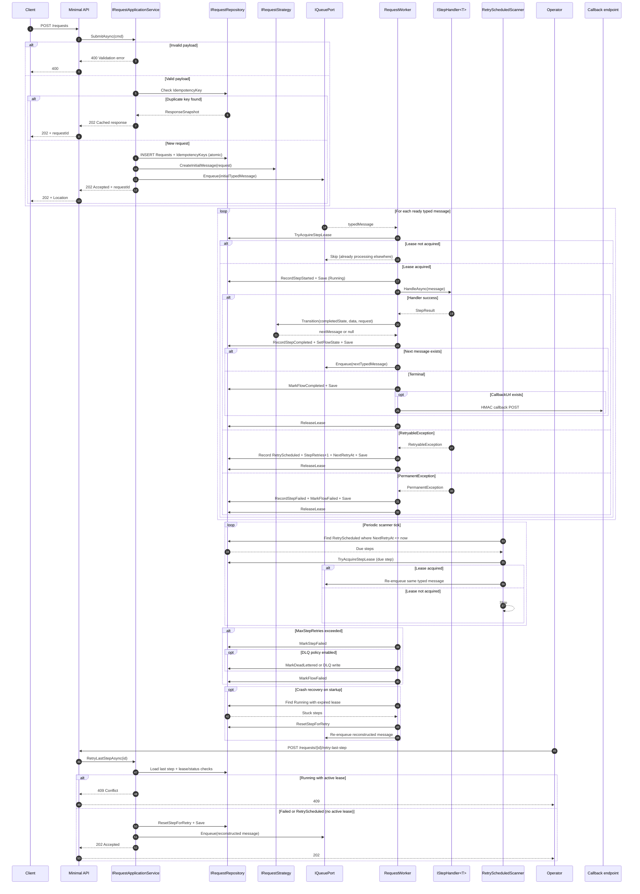
