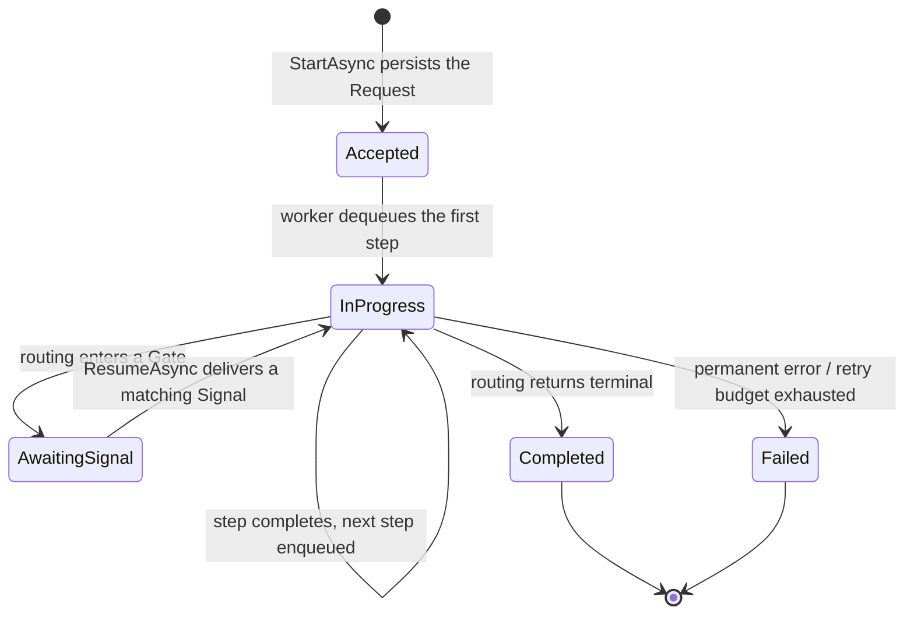
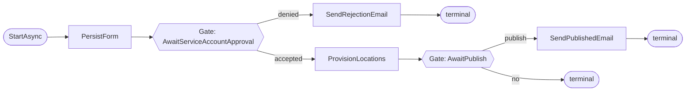

# WorkflowEngine — Public API Design (target)

> **Status:** implemented (2026-06-09). This document describes the public API of WorkflowEngine, now
> shipped in `WorkflowEngine.Contracts` and `WorkflowEngine.Core` (see §8 for the build sequence). It
> supersedes the API described in [`ImplementationDesign.md`](./ImplementationDesign.md)
> and [`StrategyImplementationGuide.md`](./StrategyImplementationGuide.md), both of which describe an
> earlier surface that had drifted from the code (e.g. `CreateInitialMessage`, string-based `Transition`).
> Vocabulary is defined in the library glossary
> [`WorkflowEngine.Core/CONTEXT.md`](../../../src/Modules/Libraries/WorkflowEngine.Core/CONTEXT.md).
>
> Backing decisions: [ADR-0013](../../architecture/adr/0013-workflowengine-standalone-bounded-context.md)
> (standalone bounded context), [ADR-0014](../../architecture/adr/0014-workflowengine-first-class-suspend-resume.md)
> (first-class suspend/resume), [ADR-0015](../../architecture/adr/0015-workflowengine-fluent-builder-dsl.md)
> (fluent builder DSL).

## 1. Goals and non-goals

**Goals.** A public API that is consistent with the glossary, easy to use correctly, and hard to misuse,
for a library user who wants to define a durable, typed, multi-step flow with human/external wait points.

**Non-goals.** Rewriting the execution engine. The worker dispatch loop, `Channel` queue, step leases,
retry scanner, crash recovery, `IStepHandler<T>`, `StepRequest`/`StepResult`, and EF persistence are
**kept unchanged**. This is a new *authoring + runtime surface* over the existing internals (see §7).

## 2. Vocabulary (summary)

Full definitions live in the library glossary. The terms that shape the API:

- **Request** — one running workflow *instance*.
- **Flow** — the state-machine *definition/progression* (never the instance).
- **Step** — one state / unit of work; carries a typed **StepRequest** message; executed by an
  `IStepHandler<T>`.
- **Gate** — a step that does no compute and parks the Request awaiting a typed **Signal**.
- **Resume** — delivering a Signal to the Gate a Request is parked at. Distinct from **Retry** (operator
  recovery of a *failed* step).
- **Start** — submitting a new Request (the builder owns initial-step construction); **Submit** is the
  low-level escape hatch.

## 3. The two state layers

| Layer | Lives in | Values | Answers |
|---|---|---|---|
| **Request status** (flow lifecycle) | `Requests.Status` | `Accepted`, `InProgress`, **`AwaitingSignal`**, `Completed`, `Failed` | "Where is the whole instance?" |
| **Step execution status** (per attempt) | `RequestSteps.ExecutionStatus` | `Running`, `Completed`, `Failed`, `RetryScheduled` | "What happened on this attempt?" — a step name keeps at most one live (non-`Completed`) row, which the attempts of that step share and which carries the attempt count forward; each completed execution leaves its own `Completed` row. |

`AwaitingSignal` is new (ADR-0014). It is an *execution-lifecycle* state ("engine cannot proceed without
external input"), which the UI maps to an "action required" indicator. Business **milestones**
(e.g. "completed", "published") are read from `CurrentState`, not from `Status`.



## 4. Public surface

### 4.1 Runtime facade

```csharp
public interface IWorkflowClient
{
    // Start a new Request; the builder constructs the initial step from input.
    Task<Guid> StartAsync<TFlow>(object input, SubmitOptions? options = null, CancellationToken ct = default)
        where TFlow : IFlowDefinition;

    // Low-level escape hatch: caller supplies a fully built initial step.
    Task<Guid> SubmitAsync(StepRequest initialStep, SubmitOptions? options = null, CancellationToken ct = default);

    // Resume the Gate the Request is currently parked at; engine validates TSignal against that Gate.
    Task<ResumeResult> ResumeAsync<TSignal>(Guid requestId, TSignal signal, CancellationToken ct = default)
        where TSignal : class;

    // Operator recovery of a failed step (distinct from Resume).
    Task<RetryResult> RetryAsync(Guid requestId, CancellationToken ct = default);

    Task<RequestStatus?> GetStatusAsync(Guid requestId, CancellationToken ct = default);
}

public sealed record SubmitOptions(string? ClientId = null, string? CallbackUrl = null, string? IdempotencyKey = null);

public enum ResumeOutcome { Resumed, NotAwaiting, SignalTypeMismatch, RequestNotFound }
public sealed record ResumeResult(ResumeOutcome Outcome, string? AwaitedSignalType = null);

public enum RetryOutcome { Requeued, NotFailed, RequestNotFound }
public sealed record RetryResult(RetryOutcome Outcome);
```

Resume/Retry outcomes are returned as values (not exceptions) for the expected non-happy cases — resuming
a Request that is not parked, or a signal-type mismatch, is a conflict, not an error to catch on the happy
path. Idempotency falls out of the `AwaitingSignal` status check plus the `RowVersion` optimistic-
concurrency token.

### 4.2 Flow-definition builder

```csharp
public interface IFlowDefinition
{
    void Define(IFlowBuilder flow);
    StepRequest CreateInitialStep(Guid requestId, object input);
}

public interface IFlowBuilder
{
    IFlowBuilder Named(string flowName);

    // Declare states (order-independent). Each binds its handler at compile time.
    IFlowBuilder Step<TReq, THandler>() where TReq : StepRequest where THandler : class, IStepHandler<TReq>;
    IFlowBuilder Gate<TSignal>(string gateName) where TSignal : class;

    // Wire transitions out of a declared step or gate.
    ITransitionSource<TReq> From<TReq>() where TReq : StepRequest;
    IGateTransitions<TSignal> FromGate<TSignal>(string gateName) where TSignal : class;
}

public interface ITransitionSource<TReq> where TReq : StepRequest
{
    // Routing reads the completed step, its result, and a READ-ONLY snapshot (for prior-step data).
    IFlowBuilder GoTo<TNext>(Func<TReq, StepResult, IRequestSnapshot, TNext> next) where TNext : StepRequest;
    IFlowBuilder GoToGate(string gateName);
    IFlowBuilder Branch(Action<IBranch<TReq>> cases);
    IFlowBuilder Terminal();
}

public interface IGateTransitions<TSignal> where TSignal : class
{
    IFlowBuilder GoTo<TNext>(Func<TSignal, IRequestSnapshot, TNext> next) where TNext : StepRequest;
    IFlowBuilder Branch(Action<IGateBranch<TSignal>> cases);
}

public interface IBranch<TReq> where TReq : StepRequest
{
    IBranch<TReq> When<TNext>(Func<TReq, StepResult, bool> predicate, Func<TReq, StepResult, IRequestSnapshot, TNext> next) where TNext : StepRequest;
    void Otherwise<TNext>(Func<TReq, StepResult, IRequestSnapshot, TNext> next) where TNext : StepRequest;
    void OtherwiseTerminal();
}

public interface IGateBranch<TSignal> where TSignal : class
{
    IGateBranch<TSignal> When<TNext>(Func<TSignal, bool> predicate, Func<TSignal, IRequestSnapshot, TNext> next) where TNext : StepRequest;
    void Otherwise<TNext>(Func<TSignal, IRequestSnapshot, TNext> next) where TNext : StepRequest;
    void OtherwiseTerminal();
}
```

> **Routing must be pure.** `GoTo`/`When`/`Otherwise` lambdas are re-run on crash-recovery replay. They
> may read the completed step, its result, and the read-only snapshot — and nothing else. They must not do
> I/O or read mutable state. The signatures intentionally expose no `IServiceProvider`/`CancellationToken`
> to remove the temptation; purity is a contract the compiler cannot enforce.

### 4.3 Inter-step data flow

A Gate's routing receives only its Signal, yet the next step often needs data produced earlier. The
snapshot closes this gap with no mutable "context bag":

- **Original input** is available via `IRequestSnapshot.Payload` (the serialized initial step).
- **Intermediate step results** are available via a typed accessor added to the snapshot:

```csharp
public interface IRequestSnapshot
{
    Guid RequestId { get; }
    string? ClientId { get; }
    string Strategy { get; }
    RequestStatus Status { get; }
    string? CurrentState { get; }
    JsonDocument Payload { get; }
    string? CallbackUrl { get; }

    // NEW: typed read of a completed step's result (replay-safe; reads persisted, immutable data).
    TResult ResultOf<TResult>(string stepName);
}
```

> **Implemented as the by-name overload only.** An earlier draft also proposed a type-only
> `ResultOf<TResult>()`. It was dropped during implementation: the result CLR type is **not** persisted
> (the handler erases the typed result to JSON via `StepResult(JsonDocument?)` before the engine sees it),
> so a type-only lookup would have to deserialise-and-guess across every completed step — ambiguous and
> fragile. Routing/gate logic always knows which step it is reading from, so the by-name overload is
> sufficient and unambiguous.

### 4.4 Registration

```csharp
// Engine (worker, queue, retry scanner, persistence binding) + options.
builder.Services.AddWorkflowEngine(o => { o.MaxStepRetries = 5; o.LeaseDuration = TimeSpan.FromMinutes(2); });

// Explicit, type-safe registration; emits handler/gate DI and validates the flow graph at startup.
builder.Services.AddFlow<OnboardingFlow>();

// Opt-in convention sugar for the linear case (scans for IFlowDefinition implementations).
builder.Services.AddWorkflowFlowsFromAssembly(typeof(OnboardingFlow).Assembly);
```

`AddFlow` validates at startup: single entry, every state reachable, every state has a handler, every
transition/branch target exists, every Gate has a signal type — throwing `FlowDefinitionException` on any
gap. These are **startup** guarantees, not compile-time ones (gate names are strings).

## 5. Worked example — project-resource onboarding



### 5.1 Payloads, signals, handlers (user code)

```csharp
public sealed record OnboardingInput(Guid ProjectId, FormData Form);

public sealed record PersistForm(Guid RequestId, FormData Form)         : StepRequest(RequestId, nameof(PersistForm));
public sealed record ProvisionLocations(Guid RequestId, Guid FormId)   : StepRequest(RequestId, nameof(ProvisionLocations));
public sealed record SendRejectionEmail(Guid RequestId, string Reason) : StepRequest(RequestId, nameof(SendRejectionEmail));
public sealed record SendPublishedEmail(Guid RequestId)                : StepRequest(RequestId, nameof(SendPublishedEmail));

public sealed record PersistFormResult(Guid FormId);
public sealed record ApprovalDecision(bool Accepted, string? Reason);
public sealed record PublishDecision(bool Publish);

public sealed class PersistFormHandler        : IStepHandler<PersistForm> { /* save + email PI -> PersistFormResult */ }
public sealed class ProvisionLocationsHandler : IStepHandler<ProvisionLocations> { /* HEAppE; RetryableException on 5xx */ }
public sealed class SendRejectionEmailHandler : IStepHandler<SendRejectionEmail> { /* ... */ }
public sealed class SendPublishedEmailHandler : IStepHandler<SendPublishedEmail> { /* ... */ }
```

### 5.2 Flow definition

```csharp
public sealed class OnboardingFlow : IFlowDefinition
{
    public StepRequest CreateInitialStep(Guid id, object input)
        => new PersistForm(id, ((OnboardingInput)input).Form);

    public void Define(IFlowBuilder flow) => flow
        .Named("project-resource-onboarding")

        .Step<PersistForm, PersistFormHandler>()
        .Step<ProvisionLocations, ProvisionLocationsHandler>()
        .Step<SendRejectionEmail, SendRejectionEmailHandler>()
        .Step<SendPublishedEmail, SendPublishedEmailHandler>()
        .Gate<ApprovalDecision>("AwaitServiceAccountApproval")
        .Gate<PublishDecision>("AwaitPublish")

        .From<PersistForm>().GoToGate("AwaitServiceAccountApproval")

        .FromGate<ApprovalDecision>("AwaitServiceAccountApproval").Branch(c => c
            .When(s => s.Accepted,
                  (s, snap) => new ProvisionLocations(snap.RequestId, snap.ResultOf<PersistFormResult>("PersistForm").FormId))
            .Otherwise((s, snap) => new SendRejectionEmail(snap.RequestId, s.Reason ?? "denied")))

        .From<SendRejectionEmail>().Terminal()
        .From<ProvisionLocations>().GoToGate("AwaitPublish")

        .FromGate<PublishDecision>("AwaitPublish").Branch(c => c
            .When(s => s.Publish, (s, snap) => new SendPublishedEmail(snap.RequestId))
            .OtherwiseTerminal());
}
```

### 5.3 Driving it (API layer)

```csharp
// START
var id = await client.StartAsync<OnboardingFlow>(new OnboardingInput(projectId, form));

// RESUME gate 1 — engine type-checks ApprovalDecision against the parked gate, then routes accept/deny
var r1 = await client.ResumeAsync(id, new ApprovalDecision(Accepted: true, Reason: null));

// RESUME gate 2
var r2 = await client.ResumeAsync(id, new PublishDecision(Publish: true));

// STATUS — e.g. { Status: AwaitingSignal, CurrentState: "AwaitPublish", AwaitedSignalType: "PublishDecision" }
var status = await client.GetStatusAsync(id);
```

## 6. Authoring rules

- One `StepRequest` record per state; carry only what that step's handler needs.
- Handlers are pure w.r.t. routing — they do work and return a `StepResult`; they never decide what runs
  next.
- Routing (`From`/`FromGate`/`Branch`) is pure and replay-safe; read prior data only via the snapshot.
- A Gate has no handler; it declares a signal type and is left by routing off the delivered Signal.
- Resume targets the currently-awaited Gate; do not name the gate at the call site.

## 7. Engine deltas vs. unchanged

**Changes (small, additive):**

1. `IRequestSnapshot.ResultOf<T>()` — typed read of completed-step results (the concrete aggregate already
   has the underlying lookup). Closes the inter-step data gap.
2. `RequestStatus` += `AwaitingSignal`; worker branch "do not dispatch / do not fail a parked Request";
   recovery scan skips parked Requests (ADR-0014).
3. `ResumeAsync<TSignal>` + the Gate concept (a handler-less step that declares a signal type).
4. Builder layer (`IFlowBuilder`, `IFlowDefinition`, `AddFlow`, optional assembly scan) over the existing
   `IRequestStrategy`/`IStrategyRegistry`, with startup completeness validation (ADR-0015).
5. Vocabulary renames: `RequestsModuleOptions` → `WorkflowEngineOptions`; `MarkFlowFailedAsync` →
   `MarkRequestFailedAsync`; `SetFlowState` → `SetCurrentState`; `StartAsync` (DSL) vs `SubmitAsync`
   (escape hatch); doc-comment "flow-level"/"closes the flow" → Request wording.

**Unchanged:** worker dispatch loop, `Channel` queue, step leases, retry scanner, crash recovery,
`IStepHandler<T>`, `StepRequest`/`StepResult`, EF persistence/schema (except the `Status` value addition).

## 8. Build sequence (as implemented)

Because the engine had **no production consumer** (only `src/WorkflowEngine.Sample` and the unit tests),
the breaking renames and the new public surface were cheap to land. The work shipped in this order, one
commit per step, each built and tested:

1. ✅ **Vocabulary renames** — `RequestsModuleOptions`→`WorkflowEngineOptions`,
   `MarkFlowFailedAsync`→`MarkRequestFailedAsync`, `SetFlowState`→`SetCurrentState`. Pure rename, no
   behaviour change (the config section name stayed `"WorkflowEngine"`).
2. ✅ **`IRequestSnapshot.ResultOf<T>()`** — by-name overload only. The type-only overload was dropped
   because the result CLR type is not persisted (the handler erases it to JSON before the engine sees it),
   making a type-only lookup ambiguous (see §4.3).
3. ✅ **Fluent builder DSL** — `IFlowDefinition`/`IFlowBuilder`, the graph compiler to a synthesized
   `IRequestStrategy`, `AddFlow<TFlow>()`, and startup validation. (Non-gate transitions.)
4. ✅ **Gate runtime + `AwaitingSignal`** — `GateStep` sentinel, the status value, the gate DSL
   (`Gate`/`GoToGate`/`FromGate`), gate-aware validation, and the worker parking branch. **No DB migration
   was needed**: `AwaitingSignal` persists as a string in the existing `Status` column, and the awaited
   signal type is recovered from the flow definition rather than stored. (The original plan listed this as
   the highest-risk, migration-bearing step; the string-backed status removed that risk, so it was merged
   with the gate work rather than landed separately.)
5. ✅ **`IWorkflowClient`** — `StartAsync`/`SubmitAsync`/`ResumeAsync`/`RetryAsync`/`GetStatusAsync`, with
   `ResumeAsync` driving gate resolution + typed signal check. An end-to-end integration test exercises
   start → park → resume → complete over the real worker.
6. ☐ **Doc reconciliation** — refresh `ImplementationDesign.md` and `StrategyImplementationGuide.md`
   against the shipped API (the internal-mechanics sections of the former remain accurate).

## 9. Known trade-offs

- **Partial compile-time safety.** Handler/payload binding and transition lambda inputs are typed; the
  graph (gate-name matching, reachability, branch exhaustiveness) is validated at startup, not by the
  compiler.
- **Impure routing is the main footgun** — only convention-guarded (see §4.2).
- **The DSL is the API** — once consumers adopt it, builder changes are breaking; new transition shapes
  (fan-out, timeouts, sub-flows, compensation) need deliberate surface growth.
