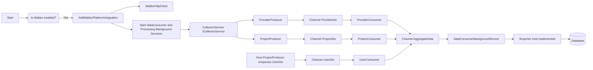
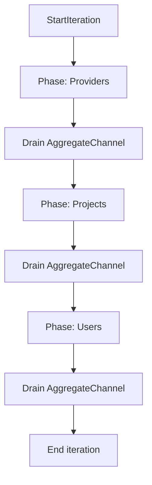

# Waldur Integration — Diagram Details (Mermaid)

The following are refined mermaid diagrams reflecting the implementation from WaldurPlatform.Base.

1) Flowchart — overall sync pipeline

2) Activity — Drain & Phase progression

Notes:
- Telemetry: SyncTelemetry exposes ActivitySource and Meter names used across the pipeline.
- Resilience: a named resilience handler ("waldur-retry") is applied to the HttpClient.
