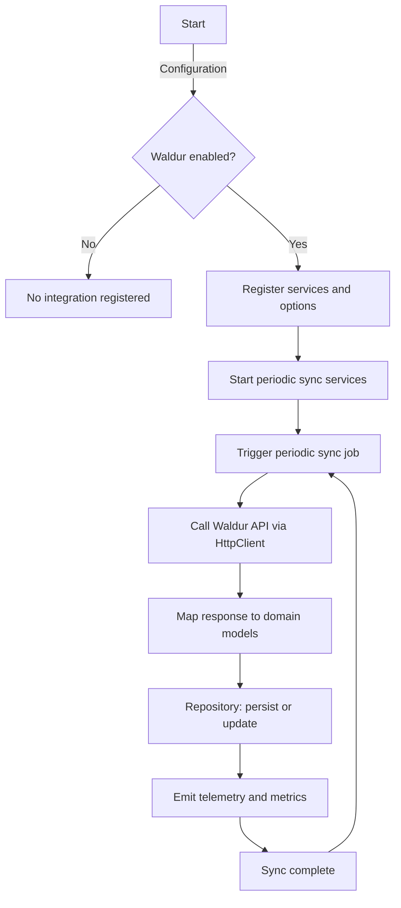

# Waldur Integration — Flow

This document describes the main integration flow (periodic synchronization scenario).

Steps
1. Application starts and calls AddWaldurIntegration at startup
2. If the configuration 'Enabled' is true, IOptions, named HttpClient and background workers are registered
3. Background worker (ProcessingBackgroundService) periodically triggers a sync iteration
4. The sync job calls the Waldur API using the named HttpClient (WaldurHttpClient)
5. Waldur responses are mapped to local models and translated into DTOs sent to the pipeline
6. The repository/exporter persists or updates entities in the database
7. Telemetry (traces and metrics) is emitted via the platform instrumentation

Mermaid flowchart

