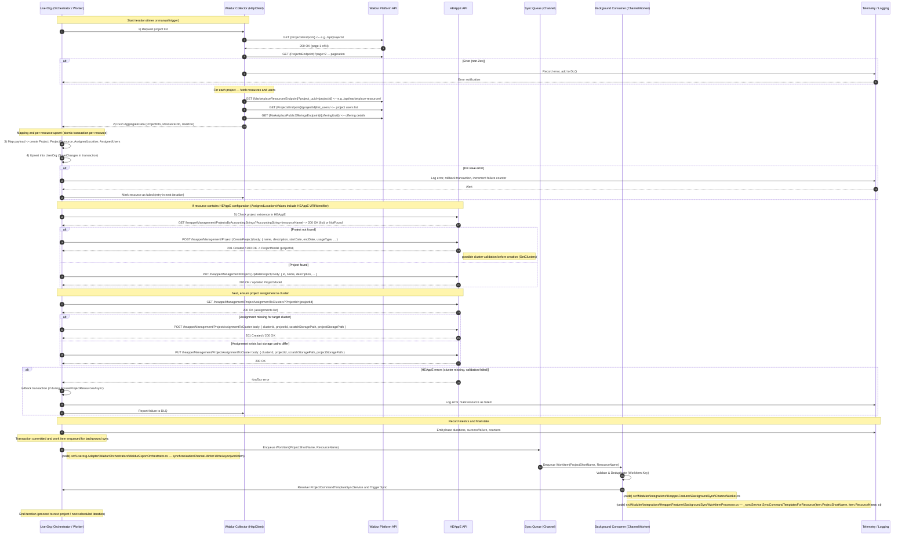

# Waldur ↔ HEAppE — Detailed Sequence Diagram (Single Iteration)

This diagram describes the specific HTTP endpoints invoked during a single synchronization iteration between UserOrg, Waldur and HEAppE. The diagram does not include authentication details (tokens/headers) but lists exact paths and possible alternative branches of behavior.

Key endpoints (summary):
- Waldur (configured in BaseIntegrationOptions):
  - {ProjectsEndpoint}               (e.g. /api/projects/)
  - {MarketplaceResourcesEndpoint}   (e.g. /api/marketplace-resources/)
  - {MarketplacePublicOfferingsEndpoint} (e.g. /api/marketplace-public-offerings/)
  - {CustomersEndpoint}              (e.g. /api/customers/)
  - Project users: {ProjectsEndpoint}/{projectId}/list_users/

- HEAppE (methods exposed by HeappeService):
  - GET /heappe/Management/ProjectsByAccountingStrings?AccountingString={resourceName}
  - POST /heappe/Management/Project
  - PUT  /heappe/Management/Project
  - GET  /heappe/Management/ProjectAssignmentToClusters?ProjectId={projectId}
  - POST /heappe/Management/ProjectAssignmentToCluster
  - PUT  /heappe/Management/ProjectAssignmentToCluster
  - GET  /heappe/Management/Clusters

Code references (enqueue & consumer):
- src\Userorg.Adapter\Waldur\Orchestrators\WaldurExportOrchestrator.cs — enqueue after tx.CommitAsync: var workItem = new WorkItem(...); await synchronizationChannel.Writer.WriteAsync(workItem, ct); (≈ lines 143–146)
- src\Modules\Integrations\Heappe\Features\BackgroundSync\ChannelWorker.cs — consumer loop resolves IProjectCommandTemplateSyncService and constructs WorkItemProcessor (reader loop ≈ lines 66–72)
- src\Modules\Integrations\Heappe\Features\BackgroundSync\WorkItemProcessor.cs — calls await _syncService.SyncCommandTemplatesForResource(item.ProjectShortName, item.ResourceName, ct); (≈ line 85)

Alternative branches shown in the diagrams:
- Waldur API does not respond (non-2xx): retry according to "waldur-retry" or write to DLQ
- Resource mapping invalid / missing data: resource skipped and recorded
- HEAppE mapping missing (no HEAppE configuration for provider): initialization skipped, error recorded
- HEAppE returns error during create/update/assignment: rollback transaction and retry/DLQ

Note: the specific names of configured endpoints are provided by the BaseIntegrationOptions implementation and set in configuration (appsettings). The diagram uses these symbolic names ({ProjectsEndpoint}, ...); in real deployments they will contain full relative paths.
