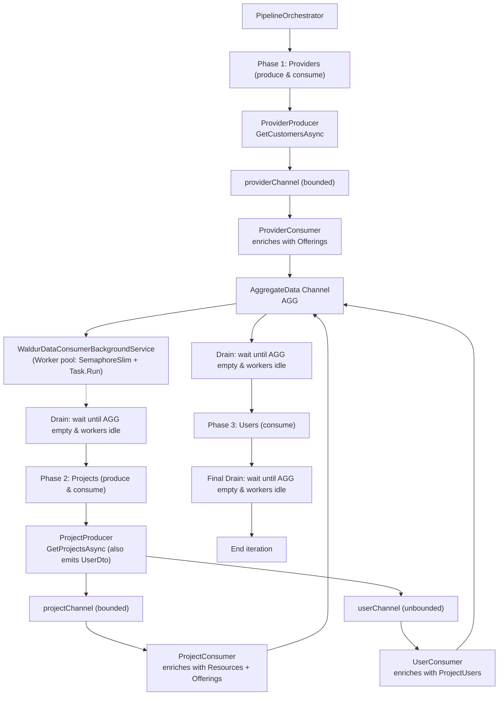
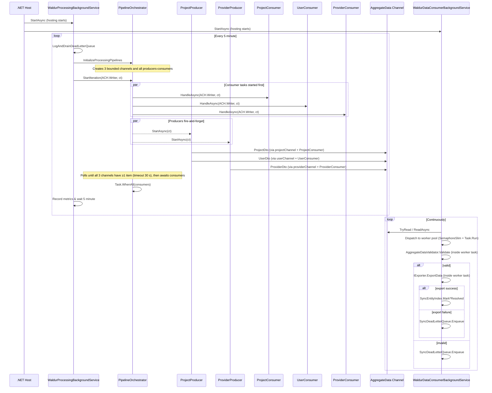

# Background Periodic Sync

## Overview

The `BackgroundPeriodicSync` feature periodically fetches data from the Waldur marketplace API and imports it into Userorg. It runs on a **configurable-minute tick** (default: 30 min) and uses a producer/consumer pipeline backed by .NET `System.Threading.Channels`. The pipeline executes in sequential phases (Providers → Projects → Users) per iteration to ensure dependency ordering, while consumers use concurrent worker slots to perform exports.

The feature comprises two cooperating `BackgroundService` instances, a per-iteration
`PipelineOrchestrator`, and a set of supporting utilities for prioritisation, validation, and
dead-lettering.

---

## High-Level Architecture




---

## Components

### `WaldurProcessingBackgroundService`

**File:** `WaldurProcessingBackgroundService.cs`
**Type:** `internal` `BackgroundService`

The outer control loop. Runs `ExecuteAsync` continuously until the application stops.

**Loop behaviour:**

1. Drains and logs the `SyncDeadLetterQueue` from the previous iteration.
2. Creates a DI scope and resolves `PipelineOrchestrator` and `ILoggerFactory`.
3. Calls `orchestrator.InitializeProcessingPipelines()` to create channels and attach
   producers/consumers.
4. Calls `orchestrator.StartIteration(dataChannel.Writer, stoppingToken)` and awaits completion.
5. Records `waldur_sync.iterations_total` counter and `waldur_sync.iteration_duration_s` histogram.
6. Sleeps for **1 minute** before the next iteration.

On `OperationCanceledException` triggered by the stopping token the loop exits cleanly.
Any other exception propagates and is recorded in the current `ActivitySource` span before
being re-thrown (which causes the host to restart the service or shut down, depending on
host configuration).

---

### `PipelineOrchestrator`

**File:** `PipelineOrchestrator.cs`
**Type:** `public` class, implements `IDisposable`

Manages the full lifecycle of one sync iteration: channel creation, producer startup, consumer
execution, and graceful shutdown.

#### `InitializeProcessingPipelines()`

Creates three **bounded** channels with a capacity of 100 and `SingleReader = true`:

| Channel | Item type | Writer | Reader |
|---|---|---|---|
| `_projectChannel` | `ProjectDto` | `ProjectProducer` | `ProjectConsumer` |
| `_userChannel` | `UserDto` | `ProjectProducer` | `UserConsumer` |
| `_providerChannel` | `ProviderDto` | `ProviderProducer` | `ProviderConsumer` |

Then creates the two producers and three consumers, injecting the appropriate channels and
`IWaldurCollectorService`.

#### `StartIteration(ChannelWriter<AggregateData> aggregateWriter, CancellationToken ct)`

1. Links the external `ct` with an internal `_lifecycleCts` so that `Dispose()` can also stop an
   active iteration.
2. Starts the three consumer tasks (`HandleAsync`) — these run until their source channel is
   completed.
3. Starts `ProjectProducer.StartAsync` and `ProviderProducer.StartAsync` as **fire-and-forget**
   (using `SafeFireAndForget` from `AsyncAwaitBestPractices`). Errors from producers are logged but
   do not propagate to the orchestrator's task.
4. Polls every **500 ms** (up to a **30-second timeout**) waiting for all three channels to contain
   at least one item. If the timeout expires, the iteration is cancelled and returns immediately.
5. Once all channels have data, awaits `Task.WhenAll` on the three consumer tasks.

#### `Dispose()`

Cancels both `_lifecycleCts` and `_iterationCts`, completes all channel writers (so consumers stop
reading), and synchronously waits up to 30 seconds for any in-flight tasks to finish.

---

### `ProjectProducer`

**File:** `Project/ProjectProducer.cs`
**Type:** `internal`

Calls `IWaldurCollectorService.GetProjectsAsync` and for **each project** writes:

- A `ProjectDto(project, [])` into `_projectChannel`
- A `UserDto(project, [])` into `_userChannel`

One call to `GetProjectsAsync` therefore produces items in **two** channels simultaneously. The
empty lists are later enriched by `ProjectConsumer` and `UserConsumer` respectively.

Metrics: increments `waldur_sync.items_produced_total` tagged with both `project` and `user`
entity types by the number of projects fetched.

---

### `ProviderProducer`

**File:** `Provider/ProviderProducer.cs`
**Type:** `internal`

Calls `IWaldurCollectorService.GetCustomersAsync` and for **each customer** writes a
`ProviderDto(customer, [])` into `_providerChannel`.

Metrics: increments `waldur_sync.items_produced_total` tagged with `provider`.

---

### `ProjectConsumer`

**File:** `Project/ProjectConsumer.cs`
**Type:** `internal`

Reads from `_projectChannel`. For each `ProjectDto`:

1. Iterates marketplace resources via `GetMarketplaceResourcesByProjectAsync`.
2. For each resource, fetches the offering via `GetMarketplacePublicOfferingAsync`.
3. If any offering fetch returns `null`, the item is marked **partial** and processing stops for
   that project (the outer `foreach` is `break`-ed and no `AggregateData` is written).
4. On success, writes an enriched `ProjectDto` (with the collected `WaldurResoruce` list) to the
   shared `aggregateWriter`.

Metrics: increments `waldur_sync.items_consumed_total` tagged with `project` on each successful
write.

---

### `UserConsumer`

**File:** `User/UserConsumer.cs`
**Type:** `internal`

Reads from `_userChannel`. For each `UserDto`:

1. Fetches all project members via `GetProjectUsersAsync`.
2. Writes an enriched `UserDto` (with the `ApiProjectUser` list) to `aggregateWriter`.

Metrics: increments `waldur_sync.items_consumed_total` tagged with `user`.

---

### `ProviderConsumer`

**File:** `Provider/ProviderConsumer.cs`
**Type:** `internal`

Reads from `_providerChannel`. For each `ProviderDto`:

1. Fetches all marketplace public offerings for the customer via
   `GetMarketplaceOfferingsByCustomerAsync`.
2. Writes an enriched `ProviderDto` (with the `ApiMarketplacePublicOffering` list) to
   `aggregateWriter`.

Metrics: increments `waldur_sync.items_consumed_total` tagged with `provider`.

---

### `WaldurDataConsumerBackgroundService`

**File:** `UserorgImport/WaldurDataConsumerBackgroundService.cs`
**Type:** `internal sealed` `BackgroundService`, registered as a **singleton hosted service**

Long-lived service that continuously drains the shared `Channel<AggregateData>` and exports items
to Userorg via `IExporter`.

#### Internal loop

```
loop (until cancellation):
    while dataChannel.Reader.TryRead(out var item):
        await _workerSlots.WaitAsync(ct)
        start background task: ProcessItemAsync(item) (Task.Run)
    if no items available:
        await dataChannel.Reader.ReadAsync(ct) // await next item, then loop
    // If SyncEntityIndex grows very large the service resets it when suitable
    if SyncEntityIndex.TotalCount > 2000:
        SyncEntityIndex.Reset()
```

The `Channel<AggregateData>` is an **unbounded singleton** shared between producers (multiple iterations write to it) and the single long-lived reader (`DataConsumerBackgroundService`). The consumer dispatches work to a worker pool using a `SemaphoreSlim` and `Task.Run` rather than an in-memory priority queue. `SingleReader = true` means the channel reader does not require additional synchronization.

Note: `PipelineDepthState.PriorityQueueDepth` exists to expose the consumer's internal buffer depth to telemetry, but currently the dispatch strategy reports zero by default; there is no separate `PriorityQueue<T>` instance in the runtime.

#### `ProcessItemAsync`

1. Determines `entityType` and `entityId` from the concrete `AggregateData` type.
2. Runs `AggregateDataValidator.Validate(item)`.
   - If invalid: logs a warning, records the activity as failed, and sends to `SyncDeadLetterQueue`.
3. Creates an async DI scope and resolves `IExporter`.
4. Dispatches to the correct `IExporter.ExportData` overload based on item type.
5. On success: marks the entity resolved in `SyncEntityIndex`, records telemetry.
6. On failure result or exception: logs, records telemetry, sends to `SyncDeadLetterQueue`.

---

## Supporting Types

### `AggregateData` hierarchy

```
AggregateData  (abstract record)
├── ProjectDto(ApiProject Project, IList<WaldurResoruce> Resources)
├── UserDto(ApiProject Project, IList<ApiProjectUser> Users)
└── ProviderDto(ApiCustomer Provider, IList<ApiMarketplacePublicOffering> Locations)
```

All three are `sealed record` types in the `Waldur.HostContracts` namespace and serve as the
output port contracts between the Waldur integration and the Userorg application layer.

---

### `AggregateDataPriority`

Historical notes in earlier designs referenced a `PriorityQueue<TElement, TPriority>` to enforce export ordering (providers → projects → users). In the current codebase there is no in-memory `PriorityQueue<T>` instance used by `DataConsumerBackgroundService`.

Current ordering and export correctness are achieved by:

- Running pipeline phases sequentially (Providers, then Projects, then Users) in `PipelineOrchestrator`, which ensures providers are produced and consumed before projects and users are processed for the same iteration.
- A single long-lived consumer (`DataConsumerBackgroundService`) that dispatches work to a bounded worker pool (configured by `WaldurOptions.SyncConsumerWorkerCount`) using `SemaphoreSlim` + `Task.Run`.
- `SyncEntityIndex` and `ProcessedItemRegistry` which track successfully exported entities and skip duplicates; these influence processing logic and visibility.

### `AggregateDataValidator`

**File:** `UserorgImport/AggregateDataValidator.cs`

Stateless validator executed before each export attempt. Returns `(IsValid, Reason)`.

| Rule | Type |
|---|---|
| `ProjectDto.Project.Slug` must not be null or whitespace | `ProjectDto` |
| `ProviderDto.Provider.Name` must not be null or whitespace | `ProviderDto` |
| Item must not be `null` | All |

`UserDto` items currently have no additional validation rules and always pass.

---

### `SyncDeadLetterQueue`

**File:** `UserorgImport/SyncDeadLetterQueue.cs`
**Registration:** `Singleton`

Thread-safe queue (`ConcurrentQueue<FailedItem>`) that stores items that could not be exported.

- `Enqueue(data, reason)` — records a `FailedItem` with the current UTC timestamp.
- `Drain()` — removes and returns all items as `IReadOnlyList<FailedItem>`.

`WaldurProcessingBackgroundService` drains the queue at the **start of each iteration** and
logs each failed item as a `Warning`.

---

### `SyncEntityIndex`

**File:** `UserorgImport/SyncEntityIndex.cs`

Thread-safe index (`ConcurrentDictionary<Guid, byte>`) of successfully exported provider and
project IDs. The `SyncEntityIndex` is consulted by export logic to determine whether dependencies (provider/project) are already resolved.

- `MarkProviderResolved(id)` / `MarkProjectResolved(id)` — called after a successful export.
- `IsProviderResolved(id)` / `IsProjectResolved(id)` — queried when deciding whether an item should be treated as dependent on a previously exported entity.
- `Reset()` — clears both dictionaries. The consumer service triggers a reset when its internal buffer is empty and `TotalCount > 2 000` to prevent unbounded memory growth.

---

## Data Flow — Sequence Diagram




## Telemetry

All instrumentation is centralised in `WaldurSyncTelemetry`.

### ActivitySource

**Name:** `UserOrg.Integrations.Waldur.Sync`

Register with OpenTelemetry via `AddWaldurSyncInstrumentation(TracerProviderBuilder)`.

| Activity name | Scope |
|---|---|
| `waldur_sync.iteration` | One background-service loop tick |
| `waldur_sync.pipeline` | Full `PipelineOrchestrator.StartIteration` call |
| `waldur_sync.project_producer` | `ProjectProducer.StartAsync` |
| `waldur_sync.provider_producer` | `ProviderProducer.StartAsync` |
| `waldur_sync.project_consumer` | Per-item in `ProjectConsumer.HandleAsync` |
| `waldur_sync.user_consumer` | Per-item in `UserConsumer.HandleAsync` |
| `waldur_sync.provider_consumer` | Per-item in `ProviderConsumer.HandleAsync` |
| `waldur_sync.data_consumer` | Per-item in `WaldurDataConsumerBackgroundService.ProcessItemAsync` |

All activities set `waldur_sync.success` (bool) tag on completion.

### Metrics (Meter: `UserOrg.Integrations.Waldur.Sync`)

Register with OpenTelemetry via `AddWaldurSyncMetrics(MeterProviderBuilder)`.

| Metric name | Type | Unit | Description |
|---|---|---|---|
| `waldur_sync.iterations_total` | Counter | — | Total completed sync iterations |
| `waldur_sync.items_produced_total` | Counter | — | Items written to producer channels (tag: `waldur_sync.entity_type`) |
| `waldur_sync.items_consumed_total` | Counter | — | Items read and processed by consumers (tag: `waldur_sync.entity_type`) |
| `waldur_sync.iteration_duration_s` | Histogram | `s` | Duration of a full sync iteration |

### Tag reference

| Tag key | Values |
|---|---|
| `waldur_sync.entity_type` | `project`, `user`, `provider` |
| `waldur_sync.project.id` | Project UUID (string) |
| `waldur_sync.provider.id` | Provider UUID (string) |
| `waldur_sync.item_count` | Long count |
| `waldur_sync.success` | `true` / `false` |

---

## Dependency Injection Registration

Registered via `IHostApplicationBuilder.AddWaldurIntegration()` in
`ServiceCollectionExtensions`:

| Service | Lifetime | Notes |
|---|---|---|
| `WaldurOptions` | Options / Scoped | Bound from `"Waldur"` config section, validated on start |
| `WaldurCollectorService` | Scoped | Implements `IWaldurCollectorService` |
| `Channel<AggregateData>` | Singleton | Unbounded, `SingleReader = true`, `SingleWriter = false` |
| `SyncDeadLetterQueue` | Singleton | Shared between producer and consumer services |
| `WaldurDataConsumerBackgroundService` | Hosted (Singleton) | Registered as `IHostedService` |

`PipelineOrchestrator` is resolved per-iteration via a DI scope inside
`WaldurProcessingBackgroundService`.

`IExporter` must be registered by the **consuming application** (Userorg Core API). It is
resolved per-item via a short-lived async DI scope inside `WaldurDataConsumerBackgroundService`.

---

## Error Handling Summary

| Scenario | Handling |
|---|---|
| Producer exception (non-cancellation) | Logged via `SafeFireAndForget`; iteration continues |
| No data in channels after 30 s | Iteration cancelled, recorded as failed in telemetry |
| Offering not found for a project resource | Item marked partial, skipped (no DLQ entry) |
| Validation failure (`AggregateDataValidator`) | Warning logged, item sent to DLQ |
| Export returns failure result | Warning logged, item sent to DLQ |
| Export throws unexpected exception | Error logged, item sent to DLQ |
| DLQ items | Logged as `Warning` at the start of the next iteration, then discarded |
| `OperationCanceledException` (stopping token) | Propagated cleanly; loop exits |

---

## HTTP Resilience

The `IWaldurCollectorService` implementation uses a named `HttpClient`
(`Constants.WaldurHttpClientName`) configured with:

- **Exponential back-off retry** (`Polly` / `Microsoft.Extensions.Http.Resilience`) on HTTP 5xx
  and `429 TooManyRequests`.
- **Rate-limit handler** (`RateLimitHandler`) applied as a `DelegatingHandler`.
- Optional **timeout** (`WaldurOptions.Timeout`).
- Configurable `RetryCount`, `RetryInitialBackoffMs`, and `RetryMaxDelayMs` via `WaldurOptions`.
