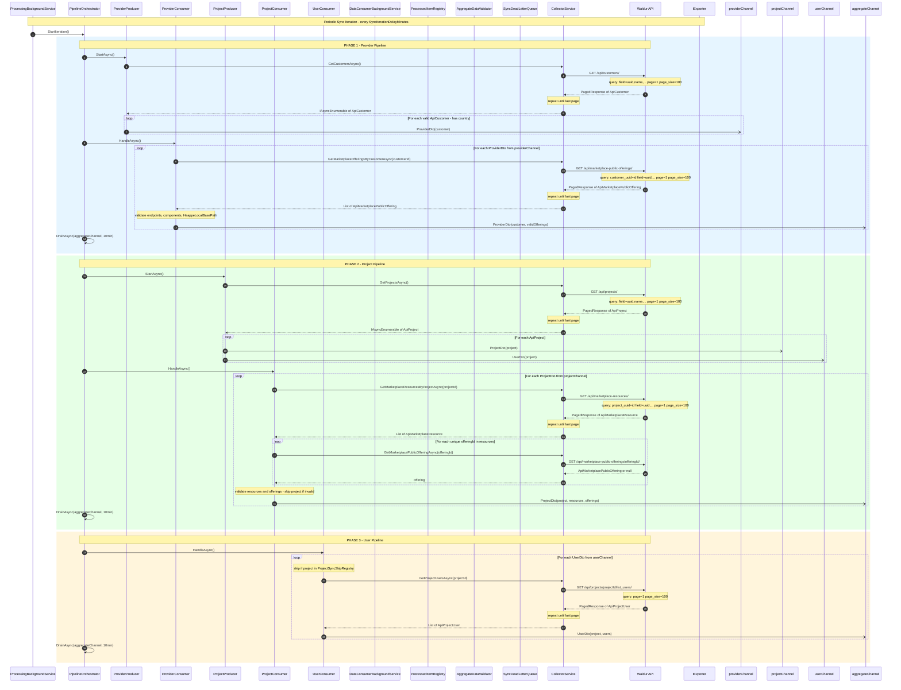

# WaldurPlatform.Base - Synchronization Sequence Diagram

## Channels (System.Threading.Channels)

| Channel | Producer | Consumer | Content |
|---|---|---|---|
| `providerChannel` | `ProviderProducer` | `ProviderConsumer` | `ProviderDto(customer, [])` |
| `projectChannel` | `ProjectProducer` | `ProjectConsumer` | `ProjectDto(project, [])` |
| `userChannel` | `ProjectProducer` | `UserConsumer` | `UserDto(project, [])` |
| `aggregateChannel` | `ProviderConsumer`, `ProjectConsumer`, `UserConsumer` | `DataConsumerBackgroundService` | `ProviderDto` / `ProjectDto` / `UserDto` (enriched) |

## Waldur API Endpoints

| Endpoint | HTTP | Pagination | Called By |
|---|---|---|---|
| `GET /api/customers/` | GET | ✓ | `ProviderProducer` |
| `GET /api/marketplace-public-offerings/?customer_uuid={id}` | GET | ✓ | `ProviderConsumer` |
| `GET /api/projects/` | GET | ✓ | `ProjectProducer` |
| `GET /api/marketplace-resources/?project_uuid={id}` | GET | ✓ | `ProjectConsumer` |
| `GET /api/marketplace-public-offerings/{offeringId}/` | GET | ✗ | `ProjectConsumer` |
| `GET /api/projects/{projectId}/list_users/` | GET | ✓ | `UserConsumer` |

## Validation Before DB Import

Each item from `aggregateChannel` goes through three steps before calling `IExporter.ExportData()`.

### Step 1 - Deduplication (`ProcessedItemRegistry`)

| Check | Key | Result on Match |
|---|---|---|
| Item has not been processed in this iteration | `{entityType}:{entityId}` (e.g., `Project:guid`) | Skip and increment `DuplicateProcessingDetectedCounter` |

The registry is reset by calling `Reset()` at the beginning of each new iteration.

### Step 2 - Data Structure Validation (`AggregateDataValidator`)

#### ProjectDto

| Field | Rule | Error Message |
|---|---|---|
| `Project.Id` | must not be `Guid.Empty` | `ProjectDto has an empty 'Id' attribute and cannot be exported.` |
| `Project.Name` | must not be null/empty | `ProjectDto {id} has an empty 'Name' attribute and cannot be exported.` |
| `Project.Slug` | must not be null/empty | `ProjectDto {id} has an empty 'Slug' attribute and cannot be exported.` |
| `Project.Created` | must not be null | `ProjectDto {id} has an empty 'CreatedAt' attribute and cannot be exported.` |
| `Resources` | must contain at least 1 record | `ProjectDto {id} has no resources and cannot be exported.` |
| `Resource.EffectiveId` / `Resource.BackendId` | at least one value must be non-empty | `ProjectDto {id} contains a resource with an empty 'EffectiveId' and 'BackendId' attributes and cannot be exported.` |
| `Resource.Id` | must not be `Guid.Empty` | `ProjectDto {id} contains a resource with an empty 'Id' attribute and cannot be exported.` |
| `Resource.Name` | must not be null/empty | `ProjectDto {id} contains a resource with an empty 'Name' attribute and cannot be exported.` |
| `Resource.State` | must not be null/empty | `ProjectDto {id} contains a resource with an empty 'State' attribute and cannot be exported.` |
| `Offering.Name` | must not be null/empty | `ProjectDto {id} contains a resource with an empty offering 'Name' attribute and cannot be exported.` |
| `Offering.State` | must not be null/empty | `ProjectDto {id} contains a resource with an empty offering 'State' attribute and cannot be exported.` |

#### ProviderDto

| Field | Rule | Error Message |
|---|---|---|
| `Provider.Id` | must not be `Guid.Empty` | `ProviderDto has an empty 'Id' attribute and cannot be exported.` |
| `Provider.Name` | must not be null/empty | `ProviderDto {id} has an empty 'Name' attribute and cannot be exported.` |
| `Provider.Country` | must not be null/empty | `ProviderDto {id} has an empty 'Country' attribute and cannot be exported.` |
| `Locations` | must contain at least 1 record | `ProviderDto {id} has no locations and cannot be exported.` |
| `Location.Name` | must not be null/empty | `ProviderDto {id} contains a location with an empty 'Name' attribute and cannot be exported.` |
| `Location.Slug` | must not be null/empty | `ProviderDto {id} contains a location with an empty 'Slug' attribute and cannot be exported.` |
| `Location.State` | must not be null/empty | `ProviderDto {id} contains a location with an empty 'State' attribute and cannot be exported.` |
| `Location.Type` | must not be null/empty | `ProviderDto {id} contains a location with an empty 'Type' attribute and cannot be exported.` |
| `Location.Endpoints` | must not be null or empty | `ProviderDto {id} contains a location with an empty 'Endpoints' attribute and cannot be exported.` |

#### UserDto

| Field | Rule | Error Message |
|---|---|---|
| `Project.Id` | must not be `Guid.Empty` | `UserDto has an empty 'Project.Id' attribute and cannot be exported.` |
| `Project.Name` | must not be null/empty | `UserDto {id} has an empty 'Project.Name' attribute and cannot be exported.` |
| `Project.Slug` | must not be null/empty | `UserDto {id} has an empty 'Project.Slug' attribute and cannot be exported.` |
| `Project.Created` | must not be null | `UserDto {id} has an empty 'Project.CreatedAt' attribute and cannot be exported.` |
| `Users` | must contain at least 1 record | `UserDto {id} has no users and cannot be exported.` |
| `User.Id` | must not be `Guid.Empty` | `UserDto for project {id} contains a user with an empty 'Id' attribute and cannot be exported.` |
| `User.UserName` | must not be null/empty | `UserDto for project {id} contains a user with an empty 'Username' attribute and cannot be exported.` |
| `User.UserEmail` | must not be null/empty | `UserDto for project {id} contains a user with an empty 'UserEmail' attribute and cannot be exported.` |
| `User.RoleId` | must not be `Guid.Empty` | `UserDto for project {id} contains a user with an empty 'RoleId' attribute name and cannot be exported.` |
| `User.RoleName` | must not be null/empty | `UserDto for project {id} contains a user with an empty 'RoleName' attribute and cannot be exported.` |

### Step 3 - Export (`IExporter.ExportData`)

It is called only after successful completion of steps 1 and 2. Results:

| Result | Action |
|---|---|
| `Result.Success` | Item imported into DB, increment `ItemExportedCounter` |
| `Result.Failure(errors)` | Enqueue to `SyncDeadLetterQueue` with `FailureType = Export` |
| Unexpected exception | Enqueue to `SyncDeadLetterQueue` with `FailureType = Unexpected` |

### Offering Validation - `WaldurModelsExtensions.ValidateAndLog`

Runs in `ProviderConsumer` before writing to `aggregateChannel` (part of the enrich step in phase 1).

| Rule | Condition | Error |
|---|---|---|
| Endpoints exist | `Endpoints` must not be null or empty | `Missing or empty endpoints` |
| Components exist | `Components` must not be null or empty | `Missing or empty components` |
| Login node endpoint | At least one endpoint with `Name == LocationLoginNodeEndpointName` | `Missing endpoint {LocationLoginNodeEndpointName}` |
| HPC HeappePath | For `Type == WaldurResourceTypeHPC`, `HeappeLocalBasePath` must be non-null | `HPC offering missing HeappeLocalBasePath` |

